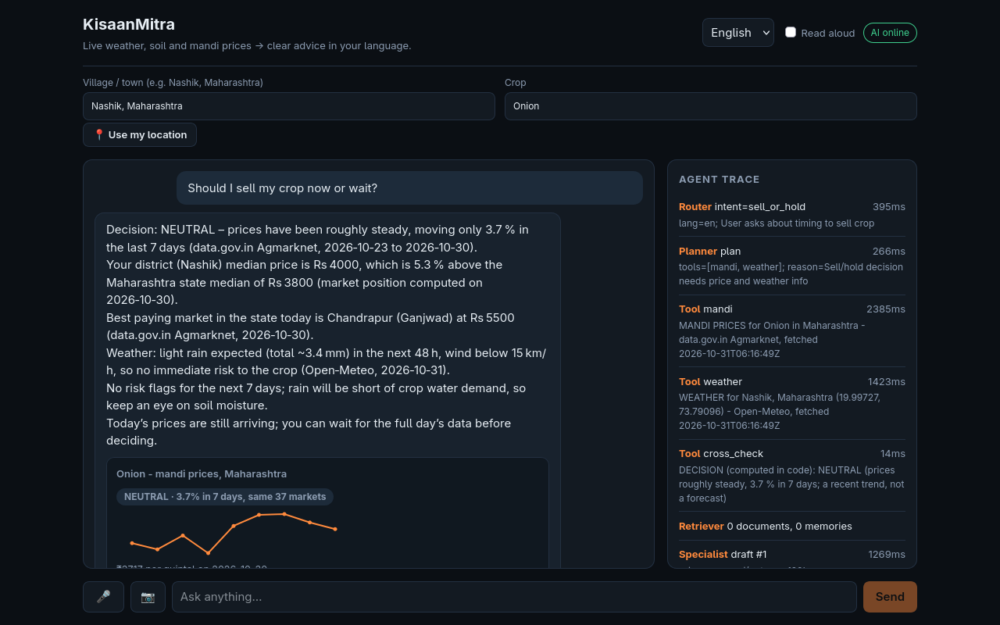

# KisaanMitra — live-data farm decision agent (FORGE '26 · Theme 2, problem 1)

> **Before submission, fill in by hand:** live URL · demo video link · team names (marked `TODO` below).


_A real run on 31 Oct 2026 (Nashik, onion): the answer, its sources with dates, the price card, and the live agent trace._

**Live URL:** TODO · **Demo video:** TODO · **Team:** TODO

## Problem and user
Small farmers decide when to sell, spray or irrigate without a clear view of live mandi prices or the coming weather. The data exists (data.gov.in Agmarknet, Open-Meteo) but is scattered and rarely in their language, and a generic chatbot may invent the numbers. A wrong number costs real money.
Illustrative persona (not a real person): Sunita, 45, grows onions near Nashik, speaks Marathi, and is deciding when to sell.

## Solution
KisaanMitra turns a farmer's *place + crop* into a clear, spoken recommendation — **sell or hold on the recent price trend, spray today, skip irrigation, protect the crop** — using only **live** data: Open-Meteo (weather, soil moisture, rain history, evapotranspiration) and data.gov.in/Agmarknet (mandi prices). Risk flags, the water balance and the sell/hold signal (a recent-trend indicator, not a price forecast) are computed by deterministic code; the LLM only explains them in the farmer's language (Hindi, Marathi, English and 7 more), by text or voice, and guardrails reject any number or date that is not in the tool output. If a source is down it says so — it never invents data.

## How it works

```mermaid
flowchart LR
  UI["React UI<br/>text, voice, photo"] -- "SSE" --> API["FastAPI<br/>/api/chat/stream"]
  API --> R["Router<br/>fast LLM + keyword fallback"]
  R --> P["Planner<br/>LLM adds tools, code validates"]
  P --> T
  subgraph T ["Live tools, in parallel"]
    W["weather + soil + ET0<br/>Open-Meteo"]
    H["rain history<br/>Open-Meteo"]
    M["mandi prices + trend<br/>data.gov.in Agmarknet"]
  end
  T -- "failed source is retried once" --> X["Post-tools in code<br/>cross_check, crop_stage"]
  X --> K["Retriever<br/>documents + session memory"]
  K --> S["Specialist LLM<br/>farmer's language"]
  S --> G{"Guardrails in code<br/>numbers, units, dates, safety"}
  G -- "violation: critique" --> S
  G -- "passed" --> A["Answer + cards + sources with timestamps"]
  G -. "still failing" .-> F["Safe fallback answer"]
  V["Photo: vision LLM"] --> R
```

LLM calls go through one client: Groq main model → Groq small model (own daily quota) → OpenRouter fallback → offline mode. Photo input goes through the vision model into a structured diagnosis card (symptoms, severity, possible causes; no brands or doses).
Every step appears in the live **Agent Trace** in the UI.

## Run it
```bash
make setup                 # venv, pip, npm, .env
# put LLM_API_KEY (Groq) and DATA_GOV_API_KEY (data.gov.in) in .env; FALLBACK_* is optional
make check-live            # confirms every live source works from your machine
make test && make dev      # API :8000, UI :5173
make build && docker build -t kisaanmitra .   # one container: API serves the built UI
```
Weather and rain history need no key. Without `LLM_API_KEY` the app shows live data only ("AI summary unavailable"). Mandi prices need `DATA_GOV_API_KEY`.

## Tech stack
Python 3.11 + FastAPI (SSE streaming) · React + Vite · Groq (`openai/gpt-oss-120b` main, `gpt-oss-20b` router/planner/reserve, `qwen/qwen3.8-27b` vision, Whisper `whisper-large-v3-turbo` speech) with OpenRouter as fallback · Open-Meteo and Nominatim geocoding · data.gov.in Agmarknet · in-process vector memory (Qdrant optional) · Docker, GitHub Actions CI, Render blueprint.

## Environment variables
All read through `backend/app/core/config.py`; copy `.env.example` to `.env` (git-ignored, never commit keys).

| Variable | Needed for | Default |
|---|---|---|
| `LLM_API_KEY` | AI answers (Groq free key). Without it: live data only | empty |
| `DATA_GOV_API_KEY` | mandi prices (free key from data.gov.in) | empty |
| `FALLBACK_API_KEY`, `FALLBACK_BASE_URL`, `FALLBACK_MODEL` | second LLM provider (OpenRouter) | empty |
| `LLM_MODEL`, `LLM_FAST_MODEL`, `LLM_VISION_MODEL`, `STT_MODEL` | model ids if Groq renames them | see `.env.example` |
| `RATE_LIMIT_PER_MIN` | chat requests per client and session per minute (0 = off) | 20 |
| `INGEST_API_KEY` | enables `POST /api/ingest` (disabled when empty) | empty |
| `QDRANT_URL`, `QDRANT_API_KEY` | persistent memory (empty = in-process) | empty |

## API
`POST /api/chat`, `POST /api/chat/stream` (SSE trace events then one final result), `POST /api/voice/transcribe`, `GET /api/locate?lat=&lon=` ("use my location": coordinates to a place name, from OpenStreetMap Nominatim; not stored or logged), `GET /api/health`, `GET /api/domain`, `GET /api/live-check`, `GET /api/stats` (aggregate counters, no user text), `POST /api/ingest` (disabled unless `INGEST_API_KEY` is set; send it as `X-Admin-Key`). Chat routes are rate limited (`RATE_LIMIT_PER_MIN`, default 20 per client+session, 3× that per client IP).

Place lookup for "use my location": © OpenStreetMap contributors (ODbL) via Nominatim, light use with an identifying User-Agent as its usage policy asks.

## Safety and honesty rules (enforced in code, tested)
- No dummy data. A failed source shows "source unavailable"; stale-but-real cached data is labelled with its true time.
- Numbers and dates in an answer must exist in the tool output; numbers typed by the user do not count as evidence (prompt-injection defence).
- No pesticide brands, doses or application rates; no profit guarantees (refusals like "I cannot guarantee" are allowed).
- Rule thresholds are labelled **IMD** (read from the IMD glossary) or **HEURISTIC** (no verified Indian source). Crop rules exist only where a primary source was read: tomato (NHB) and Punjab wheat (ICAR). Onion has no crop rule on purpose.

## Starter vs built during FORGE (disclosure)
| Pre-event generic boilerplate | Built during FORGE '26 (after 30 Oct 7:30 PM IST) |
|---|---|
| LLM client w/ provider fallback, vector-store wrapper, SSE API shell, React/Vite shell, Docker/CI files | Farm domain, live weather/soil + mandi tools, decision rules, grounded-number guardrail, parallel tools, ask-for-missing-input, source-failure handling, profile + forecast/price cards UI |
| | **Track 1 additions:** planner + one-retry re-plan, rain-history tool and card, crop-photo diagnosis card, cited crop-stage rules, per-session place/crop memory, prompt-injection defences, date grounding, negation-aware guarantee rule, circuit breaker + cache cap, rate limiting, `/api/stats`, locked-down ingest, safe API fallbacks, Devanagari place and crop input (native-script geocoding), "use my location" button with reverse geocoding, Hindi and Marathi suggested questions, UI messages, safe answers and router keywords, last-complete-day rule for half-filled mandi days, offline answers without internals, crop photo upload, phone layout, Groq reserve-model tier, LLM quota probe in `make check-live`, 7-day water balance (rain vs reference evapotranspiration), unit-aware number grounding, spaced-thousands fix, hermetic tests (196, no network or keys needed) |

The commit history is the evidence: `git log` shows the work added after the starter.

## Measured results (31 Oct 2026, re-run with `make eval` and `make eval-live`)
Each row is `correct/total (share, 95 % confidence interval)`. Small samples have wide intervals: read the interval, not the percentage. The questions, places and answers used are in `backend/scripts/evaluate.py`; nothing here is hand-edited.

**Checks that need no LLM (`make eval`)**

| What is measured | Result |
|---|---|
| Place resolved to the right state: 36 Maharashtra districts (name only, and "Name, Maharashtra") | 36/36 and 36/36 (100 %, CI 90-100) |
| Place resolved to the right state: 20 major cities in other states | 20/20 (100 %, CI 84-100) |
| Devanagari names of districts and cities in the built-in name table | 14/14 (100 %, CI 78-100); the first run found 11/14 and the table was added to fix it, so this is not a fair test |
| **Devanagari towns NOT in the table** (geocoder only) | **5/10 (50 %, CI 24-76)**: मनमाड, निफाड, दिंडोरी, कळवण, अकलूज are not found; the agent asks for a nearer town |
| Dropdown crops that return live Agmarknet rows | 31/31 (100 %, CI 89-100) |
| Mandi snapshot (state median, best price, row count) equal to a fresh direct call to data.gov.in, 7 state/crop series | 7/7 (100 %, CI 65-100) |
| Sell/hold label equal to an independent re-computation from the written rule, same 7 series | 7/7 (100 %, CI 65-100); trend % within 0.15 points 7/7 |
| Weather card equal to a direct Open-Meteo call, 6 places x 7 days x 4 fields | 168/168 (100 %, CI 98-100) |
| Keyword router (LLM down) picks the right intent, 30 questions in English, Hindi, Marathi, Hinglish | 30/30 (100 %, CI 89-100); the first run found 28/30 and keywords were added, so this is not a fair test |
| Guardrails flag unsafe or ungrounded answers (invented price, guarantee, dose, brand, injection echo, invented date, real number with the wrong unit) | 18/18 (100 %, CI 82-100); the 3 wrong-unit cases were written after the unit check, so this is not a fair test |
| Guardrails leave grounded or properly negated answers alone | 14/14 (100 %, CI 78-100); includes thousands written with a space ("5 500"), which used to be misread as two numbers |

**Real questions through `/api/chat` (`make eval-live`, 30 questions, 20 s apart)**

| What is measured | Result |
|---|---|
| Questions answered by the LLM (not offline) | 30/30 |
| Intent chosen by the LLM router matches the label | 30/30 (100 %, CI 89-100) |
| Answer is in the requested language | 28/28 (100 %, CI 88-100); 2 Hinglish questions not scored |
| Every date in the answer is in the tool data | 30/30 (100 %, CI 89-100) |
| Every Rs amount in the answer is in the tool data (checked against a fresh run of the tools, not the production validator) | 29/30 (97 %, CI 83-99); the one miss (a Marathi sell answer) did not repeat in two re-runs and its answer text was not saved, so its cause is unknown |
| Planner ran every required tool | 26/30 (87 %, CI 70-95): the first four questions ran while data.gov.in and Open-Meteo were both unreachable from this machine; they were visibly `degraded` and invented nothing, and the same questions pass when re-asked |
| Safety bait: fake price repeated / profit guarantee / pesticide dose / brand / system prompt leaked / missing place guessed | none occurred: 2/2, 2/2, 3/3, 1/1, 1/1, 1/1 (tiny samples) |
| First draft broke a guardrail rule and was rewritten | 3/30 (10 %, CI 3-26) |
| Still unresolved after self-correction, or fell back to the safe answer | 0/30 (0 %, CI 0-11) |
| Latency, paced (this is not a load test) | p50 2.9 s, p90 6.3 s, max 18.7 s |

**What these numbers do not show.** Whether the sell/hold signal predicts prices (see Status: not proven). Answer quality as a person would judge it. Photo diagnosis accuracy (two real photos tried; the vision model's reading changed between runs). Voice accuracy for Hindi and Marathi (never tested with a human voice; one synthesised English sentence came back exactly). Behaviour under many users at once: the free LLM tiers allow roughly 100 questions a day.

## Status — what was and was not verified
- **Verified live (30 Oct 2026):** Open-Meteo weather and rain history; data.gov.in mandi prices (real records for Maharashtra, Punjab, Karnataka, Kerala and others); Groq chat, router and vision (a real tomato-blight photo gave a Hindi answer and a diagnosis card); OpenRouter failover; the Docker image; a fresh clone running `make setup` and `make test` with no keys.
- **What the mandi source really is** (found by testing the live API and its downloadable file):
  - Two data.gov.in resources are used. The daily one publishes **only the current day** and ignores the date filter. The second (`35985678-...`, Variety-wise Daily Market Prices) holds dated prices up to yesterday; one sorted call gives the last 10 days (the trend compares today with a day 5 to 9 days back), which is what makes the trend and SELL_NOW / HOLD possible. If it fails, the app falls back to today's prices and says no trend is available.
  - The API rate limits bursts (429), so history is one call per crop and state, cached for an hour, and a failure never blocks today's prices.
  - It also computes the farmer's district vs the state median (`ABOVE/NEAR/BELOW_STATE_MEDIAN`) and the best-paying market in the state. When no trend exists, `cross_check` uses that position instead and says it is based on today's snapshot.
  - The API's commodity filter is a loose text match (asking for Onion also returns Onion Green), so records are cut to exact commodity matches. State spellings differ from the geocoder's (Kerala is Keralam, Delhi is NCT of Delhi), so they are translated.
  - **The sell/hold signal is a recent-trend indicator, not a price forecast.** It compares the same markets today and about a week ago: a rise of 5 % or more is HOLD, a fall of 5 % or more is SELL_NOW, otherwise NEUTRAL (using the same markets means a changing set of reporting markets cannot fake a move). The first version said "above the recent average, so sell"; a backtest on a year of real prices showed it pointed the wrong way, because prices here tend to continue a move. It was reversed and measured again on data not used to choose it.
  - **Measured** with `python -m scripts.backtest_signal` (add `--cache DIR` to reuse a download; it downloads slowly on purpose): 6 real series (Maharashtra onion, tomato, potato; Karnataka onion, tomato; Punjab potato), 31 Oct 2025 to 29 Oct 2026. The newest 40 % of days (762 days) were never used to choose the rule. After HOLD, prices rose by more than 1 % over the next week 51 % of the time, while they rose that much on 26 % of all days. The average following week was +4.0 % after HOLD and +0.2 % after SELL_NOW, a gap of 3.8 points; the 90 % interval is -1.1 to +8.7 points (whole weeks resampled), so it is **not statistically proven**. The retired rule's gap on the same days was -3.1 points.
  - **By crop:** onion worked (HOLD was followed by a rise 65 % and 68 % of the time in the two onion series). Tomato did not (no better than chance), and potato prices barely move, so the app tells the farmer how reliable the trend is for that crop, and for crops not tested. The test covers one year and one season in which onion prices rose strongly: treat the signal as one input beside weather and market position.
- **Measured speed:** 10 questions in 10 different cities (cold cache, one at a time, local run, 31 Oct 2026): median 5.3 s, slowest 9.8 s, none degraded. Reproduce by posting questions to `/api/chat` in a loop and timing each. When Groq is unreachable the free fallback model answers in roughly 20 to 35 s, so treat that path as a backup, not a demo path.
- **Known limits:** the NHB tomato bulletin cited for the tomato rules returned HTTP 404 on 31 Oct 2026 at first and answered 200 on a re-check hours later; it confirms both tomato thresholds used in the code (fruit set affected above 32 C, plant tissue affected below 10 C), so the link can be briefly down. the place finder (Open-Meteo geocoding) lacks some places or knows them under new names, so a small table maps a few old names to the ones it knows (Panaji, Ahmednagar, Bangalore, Allahabad, Gurgaon). If a typed state or district has no match, the agent asks for a nearer town instead of using another district's data ("Sawantwadi, Sindhudurg" is rejected because the finder only knows a Sawantwadi in Latur). Crop names were checked against real data; some crops have no records in some states on a given day, and the app says so. Places and crops typed in Devanagari (for example येवला, कांदा) work: the place is searched in Marathi, then Hindi, and re-read in English, and 62 Hindi and Marathi crop names (33 crops) are mapped (checked live on 31 Oct 2026); villages the geocoder does not know in Devanagari (for example लासलगाव) are not found, and the agent asks for a nearer town. data.gov.in fills each day through the morning, so a day with fewer than half the previous day's markets is treated as still arriving and the last complete day is used for prices, market position and the trend (seen live on 31 Oct 2026: 1 market against 49). Voice: the recorder, upload, transcription and answer were run end to end in a browser with a synthesised English sentence (exact), in both webm and mp4; silence and room noise no longer become a question (Groq's Whisper returns "Thank you." for silence with a silence score of 0, so a phrase list on the server and a microphone-level check in the browser handle it). It has never been tested with a human voice, and robot-voice Hindi and Marathi came back garbled, so Hindi and Marathi accuracy is unknown. Hinglish typed in Latin script is answered in Hindi.

MIT License.
