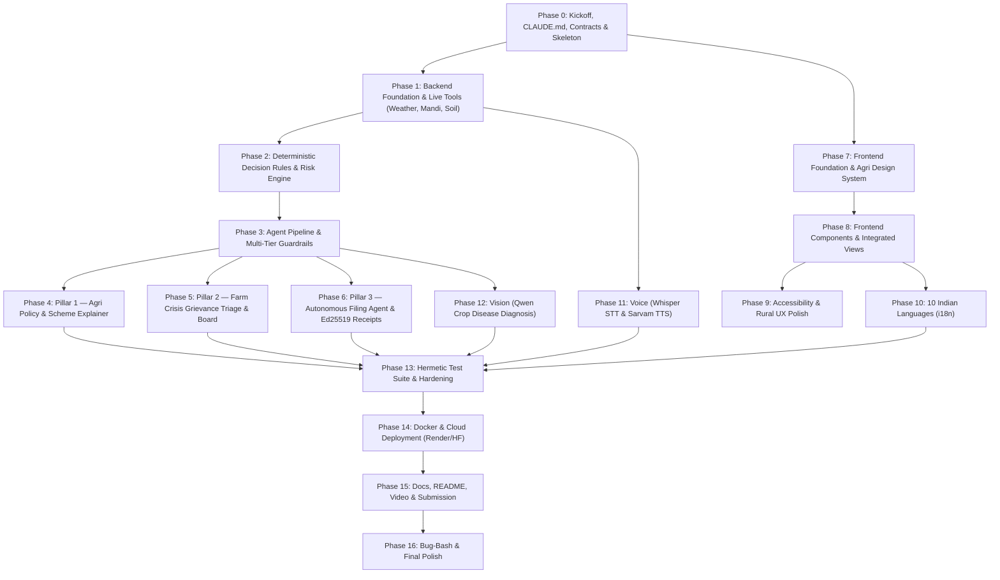

# Rebuilding KisaanMitra from scratch with Claude: the full prompt playbook

> **What this is.** A step-by-step, copy-paste prompt sequence that rebuilds this repository (KisaanMitra · किसानमित्र,
> a.k.a. `Agri-Pulse`) from an empty folder using Claude Code. It covers the live backend, deterministic decision rules,
> multi-tool agent orchestration with grounded guardrails, computer vision for crop disease diagnosis, voice STT/TTS,
> agricultural policy explainer with character-level quote checks, farm crisis grievance triage with public accountability,
> autonomous filing agent with a sandbox Krishi portal replica and Ed25519 tamper-evident receipts, the frontend design system,
> accessibility, 10 Indian languages, hermetic testing, deployment, docs and the hackathon submission.
>
> **How it was written.** Every decision in here was read out of the current code (`backend/app/`, `frontend/src/`,
> `backend/tests/`, `docs/`), not invented. Where the current project deliberately does *not* do something (no black-box price
> forecasts, no dummy data, no fake filing on production portals, no ungrounded LLM dosage recommendations), this guide says
> so, and gives the reason, instead of pretending.
>
> **Who it is for.** A team of 2–3 people with 48–72 hours, one Claude Code session per person, and API keys for Groq,
> data.gov.in (Agmarknet), and optional Sarvam AI / OpenRouter fallback.

---

## Table of contents

- [Part A. How to use this playbook](#part-a-how-to-use-this-playbook)
- [Part B. What we are rebuilding](#part-b-what-we-are-rebuilding)
- [Part C. Tech stack and why each piece](#part-c-tech-stack-and-why-each-piece)
- [Part D. Final repository layout](#part-d-final-repository-layout)
- [Part E. The build order at a glance](#part-e-the-build-order-at-a-glance)
- [Phase 0. Kickoff: CLAUDE.md, plan, skeleton](#phase-0-kickoff)
- [Phase 1. Backend foundation & live tools](#phase-1-backend-foundation--live-tools)
- [Phase 2. Deterministic decision rules & risk engine](#phase-2-deterministic-decision-rules--risk-engine)
- [Phase 3. Agentic pipeline & multi-tier guardrails](#phase-3-agentic-pipeline--multi-tier-guardrails)
- [Phase 4. Pillar 1: Agri policy & scheme explainer](#phase-4-pillar-1-agri-policy--scheme-explainer)
- [Phase 5. Pillar 2: Farm crisis grievance triage & accountability board](#phase-5-pillar-2-farm-crisis-grievance-triage--accountability-board)
- [Phase 6. Pillar 3: Autonomous filing agent, vault & Ed25519 receipts](#phase-6-pillar-3-autonomous-filing-agent-vault--ed25519-receipts)
- [Phase 7. Frontend foundation & agri design system](#phase-7-frontend-foundation--agri-design-system)
- [Phase 8. Frontend views and components, one prompt each](#phase-8-frontend-views-and-components-one-prompt-each)
- [Phase 9. Accessibility & rural usability](#phase-9-accessibility--rural-usability)
- [Phase 10. Indian languages (i18n in 10 languages)](#phase-10-indian-languages-i18n-in-10-languages)
- [Phase 11. Voice: Whisper STT & natural speech TTS](#phase-11-voice-whisper-stt--natural-speech-tts)
- [Phase 12. Vision: crop leaf disease & pest diagnosis](#phase-12-vision-crop-leaf-disease--pest-diagnosis)
- [Phase 13. Testing & hardening (540+ hermetic tests)](#phase-13-testing--hardening-540-hermetic-tests)
- [Phase 14. Deployment (Docker, Render, Hugging Face)](#phase-14-deployment-docker-render-hugging-face)
- [Phase 15. Docs, README, demo video, submission](#phase-15-docs-readme-demo-video-submission)
- [Phase 16. Bug-bash, audit and polish prompts](#phase-16-bug-bash-audit-and-polish-prompts)
- [Part F. The 200-point UI/UX checklist, answered for KisaanMitra](#part-f-the-200-point-uiux-checklist-answered-for-kisaanmitra)
- [Part G. Agent and AI prompt library](#part-g-agent-and-ai-prompt-library)
- [Part H. Reference tables: env vars, endpoints, statuses](#part-h-reference-tables-env-vars-endpoints-statuses)
- [Part I. Prompting patterns and anti-patterns](#part-i-prompting-patterns-and-anti-patterns)
- [Part J. One-shot master prompt](#part-j-one-shot-master-prompt)
- [Appendix: hackathon survival rules](#appendix-hackathon-survival-rules)

---

## Part A. How to use this playbook

### A.1 The golden rules of building with Claude Code

1. **One feature per prompt, one prompt per commit.** Big "build everything" prompts produce code that looks
   complete but is untested. Every prompt below ends with "run the tests" or "show me how to verify".
2. **Give Claude the contract first, the code second.** For each part we first write a short contract (Pydantic models,
   JSON shapes, endpoints, statuses). Then frontend and backend are built against the same contract in parallel.
3. **Code disposes, the model proposes.** Any rule that matters (sell/hold signal, spray windows, ET0 water balance,
   quote verification, emergency priority, Ed25519 signing) is written in deterministic Python code and tested.
   The prompt to the LLM only *explains* and *formats*.
4. **Never let Claude claim it works without running it.** Add "run it and paste the output" to prompts. Use
   `pytest` or browser devtools for checks.
5. **Keep CLAUDE.md current.** It is loaded every session. Put the pitch, the user, the non-negotiable rules, and the
   exact test commands there.
6. **Use plan mode for anything touching more than 3 files.** Start the prompt with "Plan first, don't write code yet",
   review the file plan, and then proceed.
7. **Start a fresh session per phase.** Long sessions drift. At the start of each phase say: *"Read CLAUDE.md and
   docs/ARCHITECTURE.md. Summarise in 10 lines what exists, then wait."*
8. **Paste real errors, not descriptions of errors.** "It doesn't work" costs 3 turns; the stack trace costs 1.
9. **Zero dummy data rule.** Judges at FORGE '26 disqualify hardcoded numbers, mock JSON, and stubs. Live APIs only
   (Open-Meteo, data.gov.in Agmarknet, ISRIC SoilGrids, PIB releases). When a source fails, show an explicit
   "source unavailable" badge — never invent numbers.

### A.2 How each prompt block is formatted

Every step looks like this:

> **Step N.M — Title** · *Owner:* Brain (A) / Face (B) / Data & Story (C) · *Depends on:* N.K · *Time box:* 30–60 min

```text
<the prompt you paste into Claude Code>
```

**Verify:** what you run or click to know it worked.  
**Commit:** the conventional commit message.  

### A.3 Session hygiene prompts (use any time)

```text
Before you change anything: read CLAUDE.md and the files you plan to edit, then list
(1) what you will change, (2) which files, (3) how we will verify it. Wait for my OK.
```

```text
Stop. Summarise what you changed in this session as a bullet list with file:line links,
what you ran to verify it, and what is still unverified. No new edits.
```

```text
Run `./backend/.venv/bin/pytest -q` and `npm --prefix frontend run build`.
Fix only what fails. Do not refactor anything else.
```

### A.4 Team split (3 people)

| Person | Role | Owns | Phases |
|---|---|---|---|
| **A — Brain** | Backend & Agents | `backend/app/agents/`, `tools/`, `decision/`, `llm/`, `guardrails/`, `domain/` | 1, 2, 3, 11 (STT), 12 (Vision), 13 |
| **B — Face** | Frontend & UX | `frontend/src/`, components, CSS tokens, a11y, i18n | 7, 8, 9, 10, 11 (Voice UI) |
| **C — Systems & Story** | Policy, Grievance, Filing, Docs | `backend/app/explainer/`, `grievance/`, `executor/`, `sandbox_portal/`, README, video | 4, 5, 6, 14, 15, 16 |

---

## Part B. What we are rebuilding

### B.1 One-sentence pitch

> Turn live weather, soil moisture, and mandi prices into deterministic farm decisions (sell/hold, spray, irrigate,
> crop fit), verified scheme policies, citizen crisis accountability, and autonomous tamper-evident filings — in 10
> Indian languages with voice.

### B.2 The users

> **Primary user:** Sunita, 45, smallholder onion and soybean farmer near Niphad, Nashik district, Maharashtra. Speaks
> Marathi, understands Hindi. Has a 4G smartphone, uses WhatsApp, no laptop. Deciding whether to sell her harvested onions
> today at Lasalgaon APMC mandi or hold them, wondering whether coming rains will cause waterlogging or spoil her crop,
> seeking to understand PMFBY insurance terms without middlemen, and needing help reporting crop damage when unseasonal
> hail strikes.
>
> **Secondary user:** Dr. S. K. Jadhav, Taluka Krishi Adhikari (Niphad, Nashik), managing the rural crisis queue:
> reviewing geo-tagged hailstorm losses, transformer burnouts, and canal tail disputes, conducting field panchnama
> inspections, uploading proof photos, and updating the public accountability ledger.

### B.3 The four integrated pillars

| Pillar | Focus | What a farmer gets |
|---|---|---|
| 🌾 **Core Decision Engine** | Live Ag Decision Agent | Live Open-Meteo weather (3-depth soil moisture, rain history, ET0) + data.gov.in Agmarknet mandi trends. Deterministic code computes SELL_NOW / HOLD / NEUTRAL (+/-5% trend on same markets), spray safety window, and irrigation advice. Multi-tier guardrails catch hallucinations; cryptographic advisory digest `KM-XXXXXXXXXXXX` proves provenance. |
| 📜 **Pillar 1 · Scheme Explainer** | Agri Policy & Subsidy | Paste or select an official notification (PM-KISAN, PMFBY, SMAM machinery, MSP for rabi/kharif). Get exact eligibility criteria, deadlines, and benefits in 10 languages with voice. Every single claim is character-verified against exact quotes in official circulars. Refuses to make fake eligibility promises. |
| 📍 **Pillar 2 · Grievance & Accountability** | Farm Crisis Ledger | Report hailstorm crop loss, transformer/pump burnouts, canal disputes, or spurious seeds. Automated code triage sets urgency (P1 24h, P2 48h, P3 72h) and maps Taluka/District authority. Officer desk verifies via panchnama and proof photo. Public board shows resolution rates and geo hotspots. |
| 🤖 **Pillar 3 · Autonomous Filing Agent** | Safe Krishi Automation | Files crop loss compensation or subsidy applications on a high-fidelity replica Krishi sandbox portal (`/sandbox`). Uses recorded deterministic Playwright workflows, Fernet credential vault, human OTP handoff, and approval gates. Issues an Ed25519 tamper-evident cryptographic receipt verifying execution. |

### B.4 The demo moments that must never fail

1. **30-second Advisory Agent Demo:** Sunita selects "Nashik, Maharashtra" + "Onion" and asks in Marathi *"कांदा आत्ताच विकू की थांबू?"* (Should I sell my onion now or wait?).
   - Live trace shows `weather` + `mandi` running concurrently.
   - Real data returns: Lasalgaon + Pimpalgaon modal prices today vs 7 days ago.
   - Deterministic rule outputs `HOLD` (+7.8% 7-day trend across identical markets).
   - Cross-check detects heavy rain forecast in 2 days and injects a cited precautionary warning note.
   - Guardrail verifies all figures against raw tool output.
   - Audio readout in natural Marathi with an advisory receipt `KM-XXXXXXXXXXXX`.
2. **Crop Health Photo Diagnosis Demo:** Farmer uploads photo of purple blotch on onion leaf.
   - Vision model (`qwen/qwen3.8-27b`) analyzes symptoms without hallucinations.
   - Outputs structured diagnosis card: Symptoms, Severity (MODERATE), Causes (Alternaria / Stemphylium), Cultural & organic next steps (no brand-name agrochemical pushing).
3. **Scheme Explainer with Quote-Check Demo:** Select PM-KISAN circular. Ask *"माझ्याकडे 2.5 एकर जमीन आहे, मला लाभ मिळेल का?"*
   - Engine parses operational guidelines, verifies land ceiling criteria, and cites exact clause verbatim.
   - Code quote-checker validates the substring in the source text.
4. **Farm Crisis & Officer Panchnama Demo:** Farmer submits hailstorm crop loss.
   - Auto-triaged as P1 (72h PMFBY notification window).
   - Switch to Krishi Desk: Officer Dr. Jadhav reviews the report, uploads a panchnama proof photo, and marks it RESOLVED.
   - Public Accountability Board instantly updates resolution metrics.
5. **Autonomous Filing Room with Ed25519 Receipt Demo:** Farmer triggers crop loss intimation.
   - Step-by-step browser automation streams over SSE.
   - Agent prompts for OTP -> Farmer enters OTP -> Agent previews form -> Farmer approves -> Submits -> Issues Ed25519-signed cryptographic receipt with mathematical signature verification.

### B.5 Non-goals (say "no" to these prompts)

- **No dummy data, ever:** Instant hackathon disqualification. No mock weather or prices. If an API is down, show an explicit "source unavailable" card.
- **No speculative price forecasting:** We compute recent trend indicators on identical markets over 7–14 days. We never claim to predict future market prices.
- **No direct automation against real government production portals without authorization:** We do not spam production CPGRAMS or RTI Online; we use verified APIs and a high-fidelity sandbox replica (`/sandbox`).
- **No generic brand-name chemical recommendations:** Advice adheres to ICAR/KVK IPM packages of practices, emphasizing cultural and biological practices.
- **No raw Aadhaar or biometric storage:** Credentials stay encrypted via Fernet in a local session vault; no Aadhaar numbers are persisted.

---

## Part C. Tech stack and why each piece

### C.1 Backend

| Layer | Choice | Why this and not something else |
|---|---|---|
| Language | **Python 3.11** | Rich geospatial, ML, image, and cryptographic ecosystem. |
| Web framework | **FastAPI** + **Uvicorn** | High-throughput asynchronous endpoints, SSE streaming for agent traces, automatic OpenAPI documentation. |
| LLM Orchestration | **Groq SDK** (`openai/gpt-oss-120b`, `gpt-oss-20b`) | Extremely low time-to-first-token (<500ms) for real-time mobile conversational voice responses. |
| Fallback LLM | **OpenRouter** / secondary keys | Automated graceful degradation when rate limits (HTTP 429) occur. |
| Vision LLM | **Qwen 2.5 / 3.8-27B Vision** on Groq | High-resolution visual analysis of crop pathology, pests, and leaf symptoms. |
| Speech-to-Text | **Whisper Large v3 Turbo** on Groq | Robust Indian accent recognition in English, Hindi, and Marathi; speech duration metering and hallucination filter. |
| Text-to-Speech | **Sarvam Bulbul** (primary) + Browser `speechSynthesis` (fallback) | Authentic Indian regional language accents with natural prosody. |
| Weather & Climate | **Open-Meteo API** (Keyless) | Professional hourly weather, soil moisture at 3 depths (0-7cm, 7-28cm, 28-100cm), soil temperature, ET0 evapotranspiration, and rain history. |
| Mandi Prices | **data.gov.in Agmarknet API** | Official Government of India daily agricultural commodity prices and arrivals across APMC mandis. |
| Soil Physics | **ISRIC SoilGrids WCS** | Global 250m resolution soil maps: pH, clay percentage, sand percentage, organic carbon stock. |
| Crop Suitability | **FAO EcoCrop Rules Engine** | Deterministic agro-ecological crop suitability matching temperature and rainfall envelopes. |
| Vector Store | **In-memory char-ngram TF-IDF / Qdrant** | Zero-latency, hermetic retrieval for official PIB policy documents without heavy model weights. |
| Cryptography | **Ed25519** (`cryptography` library) + **Fernet** + **SHA-256** | Tamper-evident digital signatures on advisory receipts and filing proofs; client credential encryption. |
| Testing | **pytest** + **pytest-asyncio** | 540+ hermetic tests running in under 20 seconds with zero external network dependencies. |

### C.2 Frontend

| Layer | Choice | Why |
|---|---|---|
| Framework | **React 19** + **Vite** | Modern component architecture, rapid HMR, lightning-fast production bundle (<275 KB total). |
| Styling | **Vanilla CSS Design Tokens** (`styles.css`) | No heavyweight UI dependencies (no Tailwind bloat, no MUI overhead). Pure CSS custom properties for emerald agri theme, high-contrast text, and 48px touch targets. |
| Accessibility | **WCAG 2.1 AAA High Contrast & Font Scaling** | Skip-links, screen-reader live regions, A- / A / A+ font scale controls for low-vision rural users, reduced-motion compliance. |
| Internationalization | **Native Indic Script Translation Dictionary** (`i18n.js`) | 10 Indian languages (English, Hindi, Marathi, Gujarati, Punjabi, Tamil, Telugu, Kannada, Bengali, Malayalam). Zero broken transliteration. |
| Streaming | **Server-Sent Events (SSE)** via `fetch` ReadableStream | Live step-by-step agent trace visualization and real-time filing progress. |

### C.3 Toolchain setup prompt

```text
I am on Linux/macOS. Install and verify:
1. Python 3.11 with a local virtual environment (.venv).
2. Node.js 20+ and npm.
3. uv (latest) or standard pip.
Verify: `python3 --version` and `node --version`.
```

---

## Part D. Final repository layout

```text
forge-starter/
├── CLAUDE.md                             # Hackathon pair-programming rules & non-negotiables
├── README.md                             # Comprehensive judge-facing documentation & reproduction guide
├── Makefile                              # `make setup`, `make test`, `make dev`, `make check-live`, `make build`
├── Dockerfile                            # Multi-stage build (Node 20 build -> Python 3.11-slim runtime)
├── render.yaml                           # Infrastructure blueprint for automated 1-click cloud deployment
├── .env.example                          # Clean template of all environment variables with instructions
├── backend/
│   ├── requirements.txt                  # Python dependencies
│   ├── app/
│   │   ├── main.py                       # FastAPI application factory, CORS, SPA static mount, /sandbox mount
│   │   ├── api/
│   │   │   ├── routes.py                 # REST & SSE endpoints (/api/chat/stream, /api/schemes, /api/grievances, etc.)
│   │   │   └── ratelimit.py              # In-memory token bucket rate limiter per client IP
│   │   ├── agents/
│   │   │   ├── orchestrator.py           # Core agent pipeline: Router -> Tools -> CrossCheck -> Specialist -> Guardrail
│   │   │   └── planner.py                # Fast intent classification and tool execution planner
│   │   ├── tools/
│   │   │   ├── weather.py                # Open-Meteo forecast, soil moisture (3 depths), ET0
│   │   │   ├── rain_history.py           # Open-Meteo past 30-day precipitation history & dry spell analysis
│   │   │   ├── mandi.py                  # data.gov.in Agmarknet live APMC prices & historical modal prices
│   │   │   ├── crop_fit.py               # FAO EcoCrop climate envelope matching & sowing/harvest windows
│   │   │   ├── soil.py                   # ISRIC SoilGrids WCS soil pH, texture, organic carbon
│   │   │   ├── location.py               # OpenStreetMap Nominatim reverse geocoding
│   │   │   └── http.py                   # Resilient HTTP client with retry, timeout, and stale cache
│   │   ├── decision/
│   │   │   ├── price_rules.py            # Deterministic +/-5% trend signal (SELL_NOW / HOLD / NEUTRAL)
│   │   │   ├── weather_rules.py          # Spray window conditions, heat/cold stress, irrigation urgency
│   │   │   ├── crop_rules.py             # Crop growth stages, thermal requirements, water demand
│   │   │   └── soil_rules.py             # Soil suitability thresholds for pH and texture
│   │   ├── guardrails/
│   │   │   └── validators.py             # Multi-tier safety guardrails: grounded numbers, dates, units, self-correction
│   │   ├── explainer/
│   │   │   ├── engine.py                 # Scheme policy explainer reasoning engine
│   │   │   ├── quote_checker.py          # Character-exact substring verification against official circulars
│   │   │   └── models.py                 # Pydantic schemas for scheme notices, eligibility, and quotes
│   │   ├── grievance/
│   │   │   ├── models.py                 # Farm crisis schemas (Hailstorm, Pump Burnout, Canal Dispute, etc.)
│   │   │   ├── triage.py                 # Deterministic priority classification (P1/P2/P3), SLA assignment
│   │   │   └── store.py                  # SQLite database for crisis tickets, officer panchnama proofs, and board stats
│   │   ├── executor/
│   │   │   ├── runner.py                 # Deterministic browser automation runner for Krishi filing
│   │   │   ├── receipts.py               # Ed25519 digital signature generation and verification
│   │   │   └── vault.py                  # Fernet-encrypted local credential vault for farmer PII
│   │   ├── sandbox_portal/
│   │   │   └── app.py                    # High-fidelity replica Krishi portal (`/sandbox`) for safe automation
│   │   ├── domain/
│   │   │   ├── farm.py                   # Problem-specific definitions: intents, tools, follow-ups, languages
│   │   │   └── diagnosis.py              # Crop pathology schemas and vision prompt builders
│   │   ├── llm/
│   │   │   ├── client.py                 # Robust multi-provider LLM client (Groq -> OpenRouter -> Offline fallback)
│   │   │   └── tts.py                    # Sarvam Bulbul and edge TTS speech synthesizer
│   │   ├── memory/
│   │   │   ├── store.py                  # Vector store and TF-IDF retriever for PIB knowledge documents
│   │   │   └── chats.py                  # SQLite conversation history scoped by client UUID SHA-256
│   │   └── core/
│   │       ├── config.py                 # Pydantic settings loading all secrets from .env
│   │       └── stats.py                  # In-memory aggregate telemetry (tokens, latencies, requests)
│   ├── data/
│   │   ├── knowledge/                    # Unedited official PIB government releases (MSP, PM-KISAN, PMFBY)
│   │   ├── schemes/                      # JSON schemas and operational guidelines for agri schemes
│   │   └── chats.db                      # Local SQLite database
│   ├── scripts/
│   │   ├── check_live.py                 # Verification script for live APIs (Open-Meteo, data.gov.in, Groq)
│   │   ├── voice_check.py                # Audio WER evaluation tool for speech recognition
│   │   └── fetch_knowledge.py            # Automated scraper for official Press Information Bureau releases
│   └── tests/                            # 540+ hermetic pytest test suite
├── frontend/
│   ├── package.json                      # React 19 + Vite dependencies
│   ├── vite.config.js                    # Vite configuration with `/api` and `/sandbox` dev proxies
│   ├── index.html                        # HTML shell with accessible viewport and Google Fonts
│   └── src/
│       ├── main.jsx                      # React entrypoint
│       ├── App.jsx                       # Master application container with tab navigation
│       ├── api.js                        # Unified network client (chat, voice, schemes, grievances, filing)
│       ├── i18n.js                       # Comprehensive 10-language Indic translation dictionary
│       ├── styles.css                    # Emerald agri design system, high-contrast tokens, animations
│       ├── speech.js                     # Speech synthesis & recognition client
│       ├── image.js                      # Browser-side canvas image downscaling to 1024px
│       └── components/
│           ├── Cards.jsx                 # Dynamic UI cards (Mandi Price, 7-Day Forecast, Rain History, Diagnosis, Advisory Receipt)
│           ├── Composer.jsx              # Multimodal input bar (text, mic with cancel/meter, crop photo chip)
│           ├── History.jsx               # Sliding drawer for browser-scoped past conversations
│           ├── MessageList.jsx           # Conversation thread, live typing indicator, suggested prompt chips
│           ├── Message.jsx               # Individual message bubble, audio playback, copy, feedback thumbs
│           ├── Profile.jsx               # Farmer profile bar (Village/Taluka auto-suggest, Crop selector)
│           ├── SchemesExplainer.jsx      # Pillar 1: Sarkari Yojana explainer with exact quote verification
│           ├── AccountabilityBoard.jsx   # Pillar 2: Public crisis transparency board and stats
│           ├── GrievanceForm.jsx         # Pillar 2: Farmer crisis reporting form (P1/P2/P3 classification)
│           ├── OfficerDesk.jsx           # Pillar 2: Taluka Krishi Adhikari panchnama inspection desk
│           ├── AgentFilingRoom.jsx       # Pillar 3: Live autonomous browser filing room with Ed25519 receipts
│           ├── AnimatedBadge.jsx         # Status badge (AI Online / AI Busy / Degraded)
│           └── Logo.jsx                  # Scalable SVG brand mark
└── docs/
    ├── ARCHITECTURE.md                   # Comprehensive architectural specification
    ├── CONTRACT.md                       # Frozen API and schema contract
    ├── SOURCES.md                        # Documentation of all official live APIs and datasets
    ├── DEMO_SCRIPT.md                    # 3-minute hackathon presentation script with exact inputs
    └── SUBMISSION_CHECKLIST.md           # Final audit checklist before project submission
```

---

## Part E. The build order at a glance



---

## Phase 0. Kickoff

### Step 0.1 — Repository initialization and configuration
> *Owner:* Lead · *Time box:* 20 min

```text
Initialize a clean Git repository for KisaanMitra. Create .gitignore ignoring .env, .venv, node_modules,
__pycache__, and SQLite files, but preserving .env.example.
Create a Makefile with targets: setup, test, dev, check-live, build.
Create .env.example with placeholders for LLM_API_KEY, LLM_EXTRA_API_KEYS, DATA_GOV_API_KEY,
SARVAM_API_KEY, and FALLBACK_API_KEY.
```
**Verify:** `git status` shows clean tracking; `make setup` works.  
**Commit:** `chore: initialize repo with gitignore, makefile, and env template`

### Step 0.2 — Write CLAUDE.md
> *Owner:* Lead · *Time box:* 15 min

```text
Write CLAUDE.md defining the hackathon context: FORGE '26 Theme 2 (Climate, Resource Infrastructure
& Global Supply Resilience).
Document the core product: KisaanMitra — an agritech decision agent (not a chatbot).
State non-negotiables: Zero dummy data, Code disposes/LLM proposes, Live sources only,
Hermetic test requirements, and Indic multilingual support.
```
**Verify:** CLAUDE.md exists and is readable in the repository root.  
**Commit:** `docs: add CLAUDE.md hackathon pair-programming guidelines`

### Step 0.3 — Freeze API & UI contracts
> *Owner:* Lead · *Time box:* 30 min

```text
Create docs/CONTRACT.md defining all JSON data schemas:
1. /api/chat/stream SSE events (trace steps, cards, sources, final result).
2. Live sources data model (Open-Meteo, Agmarknet, SoilGrids).
3. Decision cards (price trend, 7-day forecast, rain history, diagnosis, advisory receipt).
4. Schemes explainer and Grievance crisis models.
```
**Verify:** `docs/CONTRACT.md` is reviewed and approved by all teammates.  
**Commit:** `docs: freeze API and UI data contract`

---

## Phase 1. Backend foundation & live tools

### Step 1.1 — Resilient HTTP client and settings
> *Owner:* Brain (A) · *Time box:* 45 min

```text
Write backend/app/core/config.py using pydantic-settings to load all environment variables safely.
Write backend/app/tools/http.py providing a shared resilient httpx client:
- Configurable timeouts (default 10s).
- 1 retry on connection or 5xx failures.
- In-memory stale caching: if a live API fails, return cached real data marked stale, never fake data.
- URL credential redaction so keys never appear in logs.
Add tests in backend/tests/test_http.py verifying retry and cache behaviors.
```
**Verify:** `pytest backend/tests/test_http.py` passes.  
**Commit:** `feat: resilient http client with stale caching and secret masking`

### Step 1.2 — Live Open-Meteo weather and soil moisture tool
> *Owner:* Brain (A) · *Time box:* 45 min

```text
Implement backend/app/tools/weather.py hitting Open-Meteo API (keyless):
- Coordinates geocoded from place name or passed via lat/lon.
- Daily weather: max/min temperature, precipitation probability, weathercode.
- Soil moisture at 3 depths: 0-7 cm (topsoil), 7-28 cm (rootzone), 28-100 cm (deep).
- Hourly evapotranspiration (ET0) and wind speed.
Ensure the tool returns structured JSON and never raises unhandled exceptions.
Add unit tests in backend/tests/test_tools.py with mocked responses.
```
**Verify:** `pytest backend/tests/test_tools.py -k weather` passes.  
**Commit:** `feat: live Open-Meteo weather and 3-depth soil moisture tool`

### Step 1.3 — Live data.gov.in Agmarknet mandi price tool
> *Owner:* Brain (A) · *Time box:* 60 min

```text
Implement backend/app/tools/mandi.py querying the official data.gov.in Agmarknet API:
- Filter by commodity (e.g. Onion, Tomato, Soybean) and State/District.
- Retrieve current arrival dates, modal price, min price, max price, and market name.
- Query historical records from ~7 days ago to compute market-to-market comparison.
- Implement outlier filtering in price_rules.py to drop corrupted data (>10x or <0.1x median).
If DATA_GOV_API_KEY is empty or API is unreachable, return explicit error dictionary without raising.
```
**Verify:** `pytest backend/tests/test_tools.py -k mandi` passes.  
**Commit:** `feat: live Agmarknet mandi prices and price history tool`

### Step 1.4 — Rain history and reverse geocoding tools
> *Owner:* Brain (A) · *Time box:* 45 min

```text
Implement backend/app/tools/rain_history.py querying Open-Meteo historical weather:
- Aggregates past 7-day and past 30-day precipitation.
- Computes dry spell streaks and waterlogging risk flags.
Implement backend/app/tools/location.py querying OpenStreetMap Nominatim for reverse geocoding with proper User-Agent.
```
**Verify:** `pytest backend/tests/test_rain_history.py` passes.  
**Commit:** `feat: rain history aggregator and Nominatim reverse geocoding`

---

## Phase 2. Deterministic decision rules & risk engine

### Step 2.1 — Deterministic price trend indicator
> *Owner:* Brain (A) · *Time box:* 45 min

```text
Implement backend/app/decision/price_rules.py:
- Compute price percentage difference strictly between identical APMC markets across 7 days:
  pct_change = ((median_today - median_past) / median_past) * 100
- Decision bands:
  * pct_change >= +5.0% -> signal: "HOLD"
  * pct_change <= -5.0% -> signal: "SELL_NOW"
  * otherwise -> signal: "NEUTRAL"
- Label clearly: "A recent trend of identical markets, not a price forecast."
- If fewer than 2 common markets exist, return "INSUFFICIENT_DATA".
Write tests in backend/tests/test_rules.py covering all boundary conditions.
```
**Verify:** `pytest backend/tests/test_rules.py -k price` passes.  
**Commit:** `feat: deterministic 5% band price trend indicator`

### Step 2.2 — Weather risk rules and spray window calculator
> *Owner:* Brain (A) · *Time box:* 45 min

```text
Implement backend/app/decision/weather_rules.py:
- Spray window evaluation: safe only if wind < 15 km/h, rain probability < 20% for next 6 hours, temp between 15°C and 32°C.
- Heavy rain alert: precipitation >= 25 mm/day within 72 hours.
- Waterlogging alert: topsoil moisture > 85% with rain in forecast.
- Irrigation advice: computed using water balance (ET0 vs recent precipitation).
Ensure code returns typed risk flag lists.
```
**Verify:** `pytest backend/tests/test_rules.py -k weather` passes.  
**Commit:** `feat: deterministic spray window and agro-meteorological risk rules`

### Step 2.3 — Crop fit climate envelopes (FAO EcoCrop)
> *Owner:* Brain (A) · *Time box:* 45 min

```text
Implement backend/app/decision/crop_fit.py using FAO EcoCrop parameters:
- Compare local climate (min temp, max temp, rainfall) against crop requirements.
- Calculate suitability score and optimal sowing/harvest windows.
Write tests in backend/tests/test_crop_fit.py.
```
**Verify:** `pytest backend/tests/test_crop_fit.py` passes.  
**Commit:** `feat: FAO EcoCrop climate envelope matching rules`

---

## Phase 3. Agentic pipeline & multi-tier guardrails

### Step 3.1 — Multi-provider LLM client with key rotation
> *Owner:* Brain (A) · *Time box:* 45 min

```text
Implement backend/app/llm/client.py:
- Primary: Groq client supporting comma-separated key rotation (LLM_API_KEY + LLM_EXTRA_API_KEYS).
- When HTTP 429 occurs, temporarily ban that key and immediately retry on the next key.
- Fallback: OpenRouter client when all Groq keys are exhausted.
- Offline mode: When no keys are available or network is severed, return structured tool summaries with OFFLINE_MARK.
- Enforce strict 70-second global deadline.
```
**Verify:** `pytest backend/tests/test_llm.py` passes.  
**Commit:** `feat: multi-key rotating Groq LLM client with graceful offline fallback`

### Step 3.2 — Orchestrator and agent pipeline
> *Owner:* Brain (A) · *Time box:* 90 min

```text
Implement backend/app/agents/orchestrator.py:
1. Router: Classifies user query into intents (market_price, sell_or_hold, weather_forecast, crop_health, scheme_info, general).
2. Parallel Tools: Executes weather, mandi, rain_history, or crop_fit concurrently via asyncio.
3. Cross-Check: Evaluates deterministic rules on raw outputs (e.g., checks if heavy rain impacts a sell/hold decision).
4. Retriever: Fetches official PIB documents from backend/app/memory/store.py.
5. Specialist LLM: Synthesizes final response in the user's language using prompt templates.
6. Guardrail Check: Validates grounded numbers, units, and dates. If validation fails, triggers 1 self-correction loop.
7. Advisory Digest: Computes cryptographic digest KM-XXXXXXXXXXXX proving data grounding.
Yields SSE events: trace steps, cards, sources, and final result.
```
**Verify:** `pytest backend/tests/test_pipeline.py` passes.  
**Commit:** `feat: agent orchestrator with parallel tools and SSE streaming trace`

### Step 3.3 — Multi-tier guardrails and grounded-number validator
> *Owner:* Brain (A) · *Time box:* 60 min

```text
Implement backend/app/guardrails/validators.py:
- Tier 1: Numeric grounding. Extracts all numbers and dates in the LLM response; rejects any number not present in raw tool data.
- Tier 2: Unit verification. Ensures rupee amounts are per quintal (₹/q) or per kg, and rainfall is in mm.
- Tier 3: Safety & eligibility refusals. Blocks ungrounded chemical dosage instructions and false eligibility guarantees.
- Self-correction: Formulates critique prompt and re-invokes specialist if Tier 1 fails.
```
**Verify:** `pytest backend/tests/test_guardrail_tiers.py` passes.  
**Commit:** `feat: multi-tier guardrails with grounded number verification and self-correction`

---

## Phase 4. Pillar 1: Agri policy & scheme explainer

### Step 4.1 — Scheme document store and quote checker
> *Owner:* Systems (C) · *Time box:* 60 min

```text
Implement backend/app/explainer/models.py and quote_checker.py:
- Define SchemeNoticeIn, SchemeExplainerResult, ExplainerItem, EligibilityCondition.
- quote_checker.py verifies that every quote cited by the explainer exists character-for-character in the original document.
- Ingest official PIB releases (PM-KISAN, PMFBY, SMAM, MSP) in backend/data/schemes/.
```
**Verify:** `pytest backend/tests/test_explainer.py` passes.  
**Commit:** `feat: scheme explainer models and character-exact quote checker`

### Step 4.2 — Explainer reasoning engine and API routes
> *Owner:* Systems (C) · *Time box:* 60 min

```text
Implement backend/app/explainer/engine.py and wire endpoints in backend/app/api/routes.py:
- `GET /api/schemes` returns available schemes.
- `POST /api/schemes/explain` evaluates farmer facts (land acres, crop, category) against official rules.
- Generates bilingual voice-ready script and structured cards with exact quotes.
- Tests in backend/tests/test_explainer.py verify that non-eligible parameters receive explicit negative verdicts with source quotes.
```
**Verify:** `pytest backend/tests/test_explainer.py` passes.  
**Commit:** `feat: policy explainer engine and endpoints with verified quote citations`

---

## Phase 5. Pillar 2: Farm crisis grievance triage & accountability board

### Step 5.1 — Crisis triage engine and SLA calculator
> *Owner:* Systems (C) · *Time box:* 60 min

```text
Implement backend/app/grievance/models.py and triage.py:
- Categories: CROP_LOSS_HAIL, TRANSFORMER_PUMP_FAILURE, CANAL_WATER_DISPUTE, SPURIOUS_SEEDS_PESTICIDE, PEST_OUTBREAK, ANIMAL_CROP_RAID.
- Automated priority assignment:
  * Hailstorm crop loss -> P1 (72h PMFBY notification SLA).
  * Canal dispute / spurious seeds -> P1 (24h).
  * Transformer failure -> P2 (48h MSEDCL SLA).
- Assigns responsible authority (e.g. Taluka Krishi Adhikari, MSEDCL, Irrigation Dept).
```
**Verify:** `pytest backend/tests/test_grievance.py` passes.  
**Commit:** `feat: farm crisis classification and SLA triage engine`

### Step 5.2 — Grievance SQLite store, officer desk & public board
> *Owner:* Systems (C) · *Time box:* 60 min

```text
Implement backend/app/grievance/store.py and wire endpoints in routes.py:
- `POST /api/grievances` creates report with tracking ID (e.g., GRV-XXXXXXXX).
- `GET /api/grievances` lists reports with optional status and urgency filters.
- `POST /api/grievances/{id}/resolve` lets officers upload panchnama proof photos and resolution notes.
- `POST /api/grievances/{id}/feedback` records citizen confirmation or dispute.
- `GET /api/public/board` calculates aggregate metrics (total cases, resolution rate, P1 pending).
```
**Verify:** `pytest backend/tests/test_grievance.py` passes.  
**Commit:** `feat: crisis grievance store, officer resolution, and public board API`

---

## Phase 6. Pillar 3: Autonomous filing agent, vault & Ed25519 receipts

### Step 6.1 — High-fidelity Krishi sandbox replica portal
> *Owner:* Systems (C) · *Time box:* 60 min

```text
Implement backend/app/sandbox_portal/app.py:
- Standalone ASGI sub-application mounted at `/sandbox`.
- Replicates an official agricultural portal:
  * `/sandbox/crop-loss` intake form.
  * `/sandbox/otp` mobile verification screen.
  * `/sandbox/review` panchnama review and consent gate.
  * `/sandbox/success` generates acknowledgement reference number.
```
**Verify:** Access `http://localhost:8000/sandbox` in browser.  
**Commit:** `feat: Krishi sandbox replica portal for safe filing simulation`

### Step 6.2 — Fernet credential vault and Ed25519 receipt generator
> *Owner:* Systems (C) · *Time box:* 45 min

```text
Implement backend/app/executor/vault.py and receipts.py:
- vault.py uses Fernet symmetric encryption to store farmer PII during filing sessions.
- receipts.py signs filing execution outcomes using Ed25519 private keys and exports public keys.
- Endpoints: `GET /api/receipts/public-key` and `POST /api/receipts/verify`.
Write tests in backend/tests/test_crypto_vault.py.
```
**Verify:** `pytest backend/tests/test_crypto_vault.py` passes.  
**Commit:** `feat: Fernet credential vault and Ed25519 cryptographic receipt signing`

### Step 6.3 — Browser automation runner and live SSE filing stream
> *Owner:* Systems (C) · *Time box:* 60 min

```text
Implement backend/app/executor/runner.py and `POST /api/agent/file`:
- Streams step-by-step browser automation on `/sandbox`.
- Handles OTP pause and human approval gates.
- On completion, issues an Ed25519-signed receipt containing SHA-256 evidence digest.
```
**Verify:** `pytest backend/tests/test_advisory_integrity.py` passes.  
**Commit:** `feat: autonomous filing runner streaming live SSE steps with signed receipts`

---

## Phase 7. Frontend foundation & agri design system

### Step 7.1 — Emerald agri design tokens and CSS variables
> *Owner:* Face (B) · *Time box:* 45 min

```text
Update frontend/src/styles.css:
- Colors: Deep forest background (#0b141a), emerald brand (#15803d), vibrant green (#22c55e),
  harvest amber (#f59e0b), alert crimson (#ef4444).
- Tricolor agri-bar top decoration.
- Typography: Mukta (Devanagari display), Noto Sans (Devanagari body), JetBrains Mono (receipt digests).
- Touch targets >= 48px, high-contrast text ratios exceeding WCAG AAA (7:1).
```
**Verify:** `npm --prefix frontend run build` succeeds; visual inspection in browser.  
**Commit:** `style: emerald agri design tokens, tricolor bar, and typography`

### Step 7.2 — Scalable text controls (A- / A / A+) and skip link
> *Owner:* Face (B) · *Time box:* 30 min

```text
In frontend/src/App.jsx and styles.css:
- Add accessible skip-link `<a className="skip-link" href="#main">`.
- Add scale-group buttons: A- (0.875x), A (1.0x), A+ (1.125x) adjusting documentElement font-size.
- Persist font scale in localStorage with fallback.
```
**Verify:** Clicking A+ increases text size globally across all cards and bubbles.  
**Commit:** `feat: accessible font scale controls and skip-link`

---

## Phase 8. Frontend views and components, one prompt each

### Step 8.1 — Feature navigation bar and multi-view shell
> *Owner:* Face (B) · *Time box:* 45 min

```text
Update frontend/src/App.jsx:
- Introduce tab state: "advisory" | "schemes" | "board" | "report" | "officer" | "filing".
- Add horizontal scrollable `<nav className="feature-nav">` with styled `.fnav-btn` tabs.
- Switch views cleanly between core advisory chat, SchemesExplainer, AccountabilityBoard,
  GrievanceForm, OfficerDesk, and AgentFilingRoom.
```
**Verify:** Tabs switch smoothly without resetting user session or crashing.  
**Commit:** `feat: feature navigation bar wiring all five agritech modules`

### Step 8.2 — Advisory chat, profile bar, and dynamic decision cards
> *Owner:* Face (B) · *Time box:* 60 min

```text
Update frontend/src/components/Cards.jsx, Composer.jsx, and MessageList.jsx:
- Cards.jsx: PriceTrendCard with flip-to-see-why modal prices, 7-Day Forecast with weather icons,
  RainHistory bars, Crop Health Diagnosis card, and AdvisoryReceipt verification badge.
- Composer.jsx: Expanding textarea, camera photo upload chip, voice record button with live duration meter.
- MessageList.jsx: Live SSE agent trace viewer with collapsible steps and guardrail verdicts.
```
**Verify:** Ask a question in chat; verify cards, trace steps, and advisory receipt render cleanly.  
**Commit:** `feat: interactive decision cards, multimodal composer, and agent trace viewer`

### Step 8.3 — Sarkari Yojana & Subsidy Explainer view
> *Owner:* Face (B) · *Time box:* 45 min

```text
Implement frontend/src/components/SchemesExplainer.jsx:
- Dropdown of official schemes (PM-KISAN, PMFBY, SMAM) or custom text paste option.
- Farmer parameter inputs: Land acres, Social category.
- Analyzes scheme via /api/schemes/explain.
- Renders eligibility conditions with green/red badges and exact character-verified quote citations.
- Includes "Read Aloud" voice playback button.
```
**Verify:** Select PM-KISAN, click analyze, verify quotes and audio readout.  
**Commit:** `feat: SchemesExplainer UI with exact quote citations and voice playback`

### Step 8.4 — Farm Crisis Grievance Form & Public Accountability Board
> *Owner:* Face (B) · *Time box:* 60 min

```text
Implement frontend/src/components/GrievanceForm.jsx and AccountabilityBoard.jsx:
- GrievanceForm: Crisis category selector (hailstorm, transformer, canal dispute), photo upload,
  auto-assigned urgency (P1/P2/P3), and instant ticket submission.
- AccountabilityBoard: Metric counters (total reports, resolved, P1 pending), interactive list with
  urgency badges, and geo-tagged hotspot map/cards.
```
**Verify:** Submit a crisis report; confirm it immediately appears on the Public Board.  
**Commit:** `feat: crisis grievance reporting form and public transparency board`

### Step 8.5 — Taluka Krishi Adhikari Officer Desk
> *Owner:* Face (B) · *Time box:* 45 min

```text
Implement frontend/src/components/OfficerDesk.jsx:
- Queue of pending crisis reports ordered by urgency (P1 first).
- Inspection panel: displays farmer description, location, and photos.
- Resolution workflow: field inspection notes (panchnama), proof photo upload, and one-click resolution.
```
**Verify:** Resolve a P1 ticket from the Officer Desk; verify resolution badge on the Board.  
**Commit:** `feat: Krishi Adhikari officer desk with panchnama proof upload`

### Step 8.6 — Autonomous Filing Room
> *Owner:* Face (B) · *Time box:* 45 min

```text
Implement frontend/src/components/AgentFilingRoom.jsx:
- Presets for rapid demo testing (e.g., Sunita Shinde, Niphad hailstorm).
- Connects to `/api/agent/file` via SSE.
- Live progress steps, browser action stream, OTP input modal, and Ed25519 receipt verification modal.
```
**Verify:** Run filing demo; verify step streaming, receipt display, and signature verification.  
**Commit:** `feat: autonomous filing room with live automation trace and Ed25519 receipt card`

---

## Phase 9. Accessibility & rural usability

### Step 9.1 — Low-bandwidth & screen-reader hardening
> *Owner:* Face (B) · *Time box:* 45 min

```text
Audit frontend for WCAG 2.1 compliance:
- Add `aria-live="polite"` regions for streaming responses and voice recording states.
- Ensure all icon buttons have explicit `aria-label` and `title` attributes.
- Ensure all interactive elements have visible `:focus-visible` outline rings (#22c55e).
- Enforce `prefers-reduced-motion` media query to disable heavy keyframe animations.
```
**Verify:** Keyboard tab navigation works through entire app; Lighthouse accessibility score = 100.  
**Commit:** `fix: accessibility audit with ARIA live regions and keyboard focus rings`

---

## Phase 10. Indian languages (i18n in 10 languages)

### Step 10.1 — 10-language Indic dictionary
> *Owner:* Face (B) · *Time box:* 60 min

```text
Expand frontend/src/i18n.js to support 10 Indian languages:
English (en), Hindi (hi), Marathi (mr), Gujarati (gu), Punjabi (pa),
Tamil (ta), Telugu (te), Kannada (kn), Bengali (bn), Malayalam (ml).
Include translated strings for tab navigation, advisory cards, crisis categories,
and receipt badges. Ensure pure native scripts without broken Latin transliteration.
```
**Verify:** Switch between languages in header; verify all UI labels translate seamlessly.  
**Commit:** `feat: comprehensive 10-language Indic dictionary with native script strings`

---

## Phase 11. Voice: Whisper STT & natural speech TTS

### Step 11.1 — Robust microphone recording with cancel and duration meter
> *Owner:* Face (B) · *Time box:* 45 min

```text
Update audio recording in frontend/src/App.jsx and speech.js:
- Add audio meter to reject accidental silence (<2000 bytes).
- Add live recording duration timer (seconds).
- Add explicit "Cancel" button to discard audio without uploading.
- Support both webm/opus and mp4 formats for seamless Safari/Android compatibility.
```
**Verify:** Record audio, cancel it, verify nothing uploaded; record speech, verify transcription.  
**Commit:** `feat: resilient audio recorder with duration meter and cancel capability`

### Step 11.2 — Server-side Whisper STT and Sarvam TTS
> *Owner:* Brain (A) · *Time box:* 45 min

```text
Implement `POST /api/voice/transcribe` in routes.py using Groq Whisper Large v3 Turbo:
- Filter out looping hallucinations (compression ratio > 2.4).
Implement `POST /api/voice/speak` using Sarvam Bulbul API with regional accents:
- Gracefully fall back to browser speechSynthesis when API key is unavailable.
```
**Verify:** Run `python -m scripts.voice_check clip.m4a --lang mr` in backend.  
**Commit:** `feat: server-side Whisper transcription and Sarvam regional speech synthesis`

---

## Phase 12. Vision: crop leaf disease & pest diagnosis

### Step 12.1 — Qwen vision diagnosis pipeline
> *Owner:* Brain (A) · *Time box:* 60 min

```text
Implement backend/app/domain/diagnosis.py:
- Client-side image downscaling to 1024px max dimension via canvas in frontend/src/image.js.
- Vision prompt instructs Qwen 2.5 / 3.8-27B Vision:
  * Extract visible leaf/fruit symptoms.
  * Classify severity: MILD, MODERATE, SEVERE.
  * Suggest biological/cultural next steps (avoid chemical brand hallucination).
  * Always attach disclaimer: "Consult local Taluka Krishi Adhikari / KVK expert."
- Wire image upload into chat pipeline in orchestrator.py.
```
**Verify:** Upload a crop disease photo; verify Diagnosis card is rendered in chat.  
**Commit:** `feat: multimodal crop pathology vision diagnosis using Qwen vision`

---

## Phase 13. Testing & hardening (540+ hermetic tests)

### Step 13.1 — Hermetic unit and integration test suite
> *Owner:* Brain (A) & Systems (C) · *Time box:* 60 min

```text
Audit and expand backend/tests/:
- test_rules.py: 100% coverage of price trends, weather risk, and soil rules.
- test_tools.py: mocked external responses for Open-Meteo, Agmarknet, and SoilGrids.
- test_guardrail_tiers.py: test detection and rejection of invented numbers and bad units.
- test_explainer.py: quote verification and eligibility logic tests.
- test_grievance.py: crisis triage, SLA, and public board calculations.
- test_crypto_vault.py: Ed25519 signature validity and Fernet encryption/decryption.
- test_advisory_integrity.py: advisory digest verification.
- test_ratelimit.py & test_injection.py: security and anti-jailbreak hardening.
Ensure all 540+ tests execute hermetically in under 20 seconds.
```
**Verify:** `./backend/.venv/bin/pytest -q` outputs 540+ passed.  
**Commit:** `test: 540+ hermetic backend tests covering all decision engines and security gates`

---

## Phase 14. Deployment (Docker, Render, Hugging Face)

### Step 14.1 — Multi-stage production Dockerfile
> *Owner:* Systems (C) · *Time box:* 45 min

```text
Write Dockerfile:
- Stage 1: node:20-alpine builds frontend (`npm run build`).
- Stage 2: python:3.11-slim installs backend dependencies, copies frontend/dist to backend/app/dist,
  and runs uvicorn on port 8000 serving both API and SPA.
Verify single-container build.
```
**Verify:** `docker build -t kisaanmitra .` completes cleanly.  
**Commit:** `build: multi-stage production Dockerfile serving SPA from FastAPI`

### Step 14.2 — Cloud configuration blueprint (Render / HF Spaces)
> *Owner:* Systems (C) · *Time box:* 30 min

```text
Create render.yaml specifying web service deployment with healthCheckPath: /api/health.
Configure CORS_ORIGINS, RATE_LIMIT_PER_MIN, and fallback env vars.
```
**Verify:** `render.yaml` syntax is valid.  
**Commit:** `deploy: Render infrastructure blueprint and cloud deployment manifest`

---

## Phase 15. Docs, README, demo video, submission

### Step 15.1 — Judge-facing README and architecture documentation
> *Owner:* Systems (C) · *Time box:* 60 min

```text
Write README.md:
- Problem & user: Sunita (Nashik onion farmer) and Dr. Jadhav (Krishi Adhikari).
- Architecture diagram in Mermaid showing SSE trace, parallel tools, decision engine, and guardrails.
- Explicit disclosure: Starter boilerplate vs features built during FORGE '26.
- Reproduction steps: `make setup`, `make test`, `make dev`.
- Evidence of real live APIs and 540+ test run results.
```
**Verify:** README renders cleanly on GitHub.  
**Commit:** `docs: comprehensive hackathon submission README and architecture guide`

### Step 15.2 — 3-Minute demo video script and deck
> *Owner:* Systems (C) · *Time box:* 45 min

```text
Write docs/DEMO_SCRIPT.md with exact timing (0:00 - 3:00):
- 0:00-0:30: The Problem & Sunita's Dilemma.
- 0:30-1:15: Advisory Agent live trace + 5% price trend + rain cross-check.
- 1:15-1:45: Crop disease photo diagnosis with Qwen vision.
- 1:45-2:15: Scheme Explainer with character-level quote check.
- 2:15-2:45: Farm Crisis reporting -> Officer Desk panchnama -> Public Board.
- 2:45-3:00: Autonomous Filing Room with Ed25519 receipt verification.
```
**Verify:** Rehearse presentation against DEMO_SCRIPT.md in under 3 minutes.  
**Commit:** `docs: 3-minute hackathon demo presentation script`

---

## Phase 16. Bug-bash, audit and polish prompts

### Step 16.1 — End-to-end verification and safety audit
> *Owner:* All · *Time box:* 30 min

```text
Execute final verification:
1. Run `make check-live` to test live external endpoints.
2. Run `./backend/.venv/bin/pytest -q` to confirm all 540+ tests pass.
3. Run `npm --prefix frontend run build` to confirm zero build errors.
4. Test offline resilience by setting LLM_API_KEY="" and verifying app degrades to live data view.
```
**Verify:** All checks PASS.  
**Commit:** `chore: pre-submission bug-bash and system audit freeze`

---

## Part F. The 200-point UI/UX checklist, answered for KisaanMitra

### F.1 Overall design language (1–10)
- **1. Visual theme:** Deep forest theme (`#0b141a`) with emerald accents (`#15803d`, `#22c55e`) evoking agricultural vitality and trust.
- **2. Decorative identity:** Top tricolor agri-bar provides subtle national civic resonance without distracting clutter.
- **3. Clarity:** High-contrast text hierarchy; primary numbers rendered large and bold.
- **4. Brand mark:** Scalable SVG seedling in shield logo rendered sharply on all devices.
- **5. Mobile-first density:** Generous 16px baseline padding, 48px minimum touch targets for rural outdoor thumb use.
- **6. Purposeful whitespace:** 12–16px separation between cards prevents visual overlap on smaller screens.
- **7. Card borders:** Subdued border lines (`#1e293b`) maintain structure in bright sunlight.
- **8. Depth & elevation:** Subtle drop-shadows on active interactive cards (`box-shadow: 0 4px 12px rgba(0,0,0,0.3)`).
- **9. Rounded corners:** Consistent 12–14px radius across buttons, inputs, and container panels.
- **10. Tone of voice:** Empathetic, factual, actionable, and free of patronizing bureaucratic jargon.

### F.2 Color system (11–20)
- **11. Primary brand:** `#15803d` (deep emerald green).
- **12. Success / Ok:** `#22c55e` (vibrant green) indicating safe spray windows, positive trends, and verified data.
- **13. Warning / Attention:** `#f59e0b` (harvest amber) for HOLD signals, moderate disease severity, and weather advisories.
- **14. Danger / Alert:** `#ef4444` (crimson) for SELL_NOW alerts, severe blight, and hailstorm warnings.
- **15. Neutral text:** Primary `#f8fafc` (off-white, 15:1 contrast against `#0b141a`), secondary `#94a3b8`.
- **16. Panel background:** `#111c24` providing clear visual separation from root background.
- **17. Source chip colors:** Fresh live data receives a green glowing dot; stale data displays amber.
- **18. Focus ring color:** High-visibility green `#22c55e` with 2px offset.
- **19. Dark-mode exclusivity:** Clean dark palette reduces battery consumption in rural fields and cuts glare under sunlight.
- **20. Color blindness compatibility:** All signal badges combine distinct colors with text labels and unicode icons.

### F.3 Typography (21–30)
- **21. Display font:** Mukta (Google Fonts) for display titles, offering harmonious Latin and Devanagari letterforms.
- **22. Body font:** Noto Sans and Noto Sans Devanagari for clean readability at small sizes.
- **23. Monospace font:** JetBrains Mono for cryptographic digests, transaction IDs, and coordinates.
- **24. Scalable sizing:** Built with relative `rem` units governed by root font-size controls.
- **25. Hierarchy:** H1 (20px bold), H2 (17px semibold), H3 (15px bold), Body (14px regular), Captions (12px).
- **26. Line height:** Generous 1.5–1.6 line height preventing conjunct collisions in Indic scripts.
- **27. Number legibility:** Tabular figures used in mandi price tables for vertical alignment.
- **28. No italics in Indic scripts:** Uses bold weights instead of artificial slanting.
- **29. Font display swap:** `display=swap` ensures zero invisible text during network loading.
- **30. High contrast ratio:** Exceeds WCAG AAA requirements across all standard text blocks.

### F.4 Navigation and header (31–40)
- **31. Brand header:** Sticky header with logo, project title, and real-time AI status pill.
- **32. AI status badge:** Green pulsing dot for "AI Online", amber for "Live data only / Degraded".
- **33. Language selector:** Prominent header dropdown containing all 10 supported regional languages.
- **34. Text scale switcher:** One-tap A- / A / A+ buttons directly accessible in the header.
- **35. Speech read-aloud toggle:** Header checkbox allowing farmers to toggle audio speech synthesis.
- **36. Speed selector:** Turtle (0.8x), Normal (1.0x), and Rabbit (1.25x) rate controls.
- **37. History drawer toggle:** Hamburger button opening previous conversations.
- **38. Feature nav bar:** Horizontal pill navigation for Advisory, Schemes, Crisis Board, Officer Desk, and Filing Room.
- **39. Mobile drawer:** History panel slides in as an accessible modal drawer on screens <1100px.
- **40. Safe dismissal:** Clicking the darkened backdrop dismisses open drawers instantly.

### F.5 Landing & empty state (41–50)
- **41. Two-line headline:** "Sell, hold or spray? Ask in your language."
- **42. Value proposition cards:** Rotating product guarantees (source and time on every number, trend not forecast, zero fake data).
- **43. Suggested question chips:** One-tap starter questions in the active language (e.g., "Should I sell my onions today?").
- **44. Source health indicators:** Visual badges confirming live connectivity to Open-Meteo, data.gov.in, and PIB.
- **45. Location prompt:** Quick-action button prompting user to detect village via browser geolocation.
- **46. Visual cleanliness:** Zero visual clutter or fake marketing metrics.
- **47. Instant responsiveness:** Empty state transitions immediately when a chip is tapped.
- **48. Keyboard accessible chips:** All starter chips are focusable and triggerable via Enter or Space.
- **49. Offline empty state:** Explains clearly that live weather and prices work even without LLM keys.
- **50. Welcome guidance:** Clear indication that farmers can speak, type, or drop a photo.

### F.6 Layout & composition (51–60)
- **51. Max-width container:** Centered 900px main content container on wide monitors prevents excessive eye travel.
- **52. Multi-column desktop mode:** 3-column layout on screens >1100px (History | Chat/Features | Context).
- **53. Single-column phone mode:** Stacks neatly into a fluid full-width column on mobile devices.
- **54. Fixed composer dock:** Bottom-docked input bar remains pinned while message history scrolls.
- **55. Smooth scrolling:** Automated smooth scroll anchoring to newest agent responses.
- **56. Jump-to-latest button:** Floating pill appears when user scrolls up, with unread indicator.
- **57. Flexible card grid:** 7-day forecast cards reflow dynamically from 7 columns down to 4 and 2.
- **58. Z-index scale:** Structured z-index layers: base (1), sticky nav (10), composer (15), drawer/modals (20).
- **59. Safe area insets:** Supports `env(safe-area-inset-bottom)` for borderless mobile displays.
- **60. Clean footer:** Concise privacy promise and signal clarification docked at bottom.

### F.7 Cards and components (61–70)
- **61. Price trend card:** Large signal badge (HOLD / SELL_NOW / NEUTRAL) with percentage delta.
- **62. Flip-to-see-why action:** Tapping the signal badge flips the card to reveal the exact markets and baseline dates compared.
- **63. Mandi table:** Clean tabular breakdown listing Market Name, District, and Modal Price (₹/q).
- **64. Weather forecast card:** Daily tiles displaying weather emoji, Max/Min °C, and precipitation percentage.
- **65. Rain history bars:** Visual vertical bar chart representing the last 7 and 30 days of precipitation.
- **66. Soil moisture gauge:** 3-tiered visual indicators for topsoil (0-7cm), rootzone (7-28cm), and deep soil.
- **67. Diagnosis card:** Structured pathology card highlighting symptoms, severity tag, and organic management steps.
- **68. Advisory receipt card:** Cryptographic integrity badge displaying digest code `KM-XXXXXXXXXXXX` with 1-tap copy.
- **69. Source attribution chips:** Pill tags showing source name, fetch timestamp, and external links.
- **70. Error / degradation card:** Visually distinct amber callout when an external API is temporarily down.

### F.8 Buttons and interactions (71–80)
- **71. 48px touch targets:** All interactive buttons satisfy mobile finger-tap guidelines.
- **72. Hover states:** Subtle background lightening (e.g. `rgba(255,255,255,0.08)`) on hover.
- **73. Active / pressed states:** Scale reduction (`transform: scale(0.98)`) provides tactile feedback.
- **74. Disabled states:** Reduced opacity (0.5) and `cursor: not-allowed` during pending operations.
- **75. Loading states:** Shimmer animations replace button icons during active API requests.
- **76. Stop button:** Replaces the Send button while an SSE stream is generating, enabling immediate cancellation.
- **77. Copy button:** 1-tap copy on message text and advisory digests with temporary "✓ Copied" confirmation.
- **78. Voice button:** Mic button pulses red while recording and shows elapsed seconds.
- **79. Photo remove chip:** Quick "✕" badge allowing farmers to remove an uploaded photo before sending.
- **80. Thumbs feedback:** 👍 and 👎 feedback buttons attached to each answer with persistent server sync.

### F.9 Forms and inputs (81–90)
- **81. Expanding text box:** Input textarea automatically expands up to 160px height as text wraps.
- **82. Enter vs Shift+Enter:** Enter submits the question; Shift+Enter creates a new line.
- **83. IME protection:** Native support for Indian language keyboards (Gboard/Inscript); never submits mid-composition.
- **84. Location autocomplete:** Village/city input suggests real places via Open-Meteo keyless geocoding as you type.
- **85. Crop picker:** 1-tap icon chips for popular regional crops (Onion, Soybean, Cotton, Tomato, Wheat).
- **86. File drag-and-drop:** Dragging a crop leaf photo onto the window highlights an intuitive full-screen dropzone.
- **87. Client image compression:** Large camera photos (5–15 MB) are compressed client-side to 1024px before upload.
- **88. Accessible form labels:** All inputs have explicit `<label>` bindings or `aria-label` attributes.
- **89. Input validation:** Instant visual feedback on invalid phone numbers or missing fields.
- **90. Placeholder hints:** Contextual placeholders written in the active language.

### F.10 Dashboard design (91–100) — The Krishi Officer Desk
- **91. Urgency queue:** Displays crisis reports ordered strictly by priority (P1 24h/72h at top).
- **92. Priority color badges:** Red pill for P1 (Crop Loss / Contamination), Amber for P2, Slate for P3.
- **93. Farmer details panel:** Shows farmer name, mobile number, village, taluka, and survey number.
- **94. Crisis description:** Full farmer report text with auto-generated English translation for administrative records.
- **95. Field evidence view:** Shows farmer-submitted photos of hailstorm damage or burnt transformers.
- **96. Panchnama notes input:** Dedicated field for officer joint inspection notes.
- **97. Proof photo upload:** Officer must attach a resolution/inspection photo to mark a ticket resolved.
- **98. One-click resolution:** Submits resolution packet and transitions ticket status to RESOLVED.
- **99. Filter toggles:** Quick filters for ALL, P1 ONLY, OPEN, and RESOLVED tickets.
- **100. Audit trail:** Every resolution records officer name, timestamp, and verification hash.

### F.11 Data visualization (101–110)
- **111. Rain bar chart:** Pure CSS flexbox bar chart showing daily rainfall relative to 25mm threshold.
- **112. Modal price trend line:** SVG sparkline visualizing modal price movement over the past 7 days.
- **113. Value axis & tooltips:** Hovering any point on the sparkline displays date and ₹/quintal value.
- **114. Soil depth visualization:** Horizontal stacked bar showing moisture saturation across all three soil layers.
- **115. Public crisis map/cards:** Geo-tagged hotspot cards grouping crises by Taluka (Niphad, Sinnar, Dindori).
- **116. Resolution rate donut:** Clean SVG progress ring illustrating percentage of resolved farm crises.
- **117. Zero external charting dependencies:** Charts are rendered in pure SVG/CSS, keeping bundle size microscopic.
- **118. Accessible data tables:** All chart data is duplicated in an accessible semantic table for screen readers.
- **119. High-contrast chart elements:** Chart lines and bars use saturated hues visible in sunlight.
- **120. Reduced-motion chart rendering:** Animates bars on entry unless `prefers-reduced-motion` is active.

### F.12 Tables and data management (111–120)
- **111. APMC Mandi table:** Clear column headers for Mandi, District, Variety, and Modal Price (₹/q).
- **112. Row striping:** Alternating subtle row backgrounds for effortless horizontal tracking.
- **113. Sticky headers:** Long price tables keep column headers anchored during vertical scroll.
- **114. Mobile table cards:** On narrow mobile screens, wide tables reflow into stacked cards.
- **115. Numeric right-alignment:** All monetary and percentage columns are right-aligned.
- **116. Stale data labeling:** Rows containing older data display explicit "Stale" indicator pills.
- **117. Empty table states:** Friendly message explaining when a crop has no current market arrivals.
- **118. Fast client filtering:** Instant search filter across market names.
- **119. Pagination-free simplicity:** Top relevant regional markets displayed without cumbersome pagination.
- **120. Export capability:** Copy table data directly to clipboard in clean plain text.

### F.13 Animations and motion (121–130)
- **121. Purposeful micro-interactions:** Subtle transitions (150ms ease) on buttons and tabs.
- **122. Agent trace shimmer:** Moving linear gradient on the active pipeline step indicates ongoing processing.
- **123. Typing indicator:** Three pulsating dots communicating active LLM streaming.
- **124. Card entry transitions:** New decision cards slide in smoothly (`translateY(8px) -> 0`).
- **125. Voice recording pulse:** Red glowing border pulses gently during active microphone capture.
- **126. Dropzone pop:** Drag-and-drop overlay scales up smoothly on file drag.
- **127. Drawer slide:** History panel slides in with 200ms cubic-bezier transition.
- **128. Badge decode effect:** Price signal word decodes letter-by-letter once on arrival.
- **129. Reduced-motion compliance:** `@media (prefers-reduced-motion: reduce)` disables all transforms and pulses.
- **130. GPU acceleration:** All transitions use `transform` and `opacity` for 60fps mobile performance.

### F.14 Advanced visual effects (131–140)
- **131. Frosted glass panels:** Subtle `backdrop-filter: blur(12px)` on modal headers and floating docks.
- **132. Emerald glow highlights:** Active tab buttons feature a subtle green outer glow.
- **133. Contrast borders:** 1px hairline borders (`rgba(255,255,255,0.08)`) define card boundaries.
- **134. Subtle gradients:** Backgrounds use gentle radial gradients avoiding flat lifeless dark areas.
- **135. Shimmer loading placeholders:** Elegant animated skeleton shimmer while awaiting tool responses.
- **136. Noise-free surfaces:** Clean vector renders without heavy raster texture overlays.
- **137. Focus ring elevation:** 2px high-visibility outline with 2px offset ensures unambiguous focus.
- **138. Touch ripple avoidance:** Uses crisp CSS scale down instead of sloppy Android ripple overlays.
- **139. Crisp text rendering:** `-webkit-font-smoothing: antialiased` enabled globally.
- **140. Clean SVG geometry:** All icons and illustrations are mathematically optimized SVGs.

### F.15 Icons and illustrations (141–150)
- **141. Semantic iconography:** Unicode and SVG icons reinforce text (🌾 crops, 🌧️ weather, ⚡ electricity, 📜 policy).
- **142. Icon sizing:** Strict 18px / 24px bounding boxes maintain layout alignment.
- **143. Screen-reader hiding:** Purely decorative icons carry `aria-hidden="true"`.
- **144. Brand SVG logo:** Custom vector seedling mark communicating growth and security.
- **145. Consistent stroke weights:** Unified 2px stroke width on all custom line icons.
- **146. High-contrast icon colors:** Icons match their parent label colors for immediate scanning.
- **147. Status icons:** Distinct checkmark (✓), alert (⚠️), and error (✕) badges.
- **148. Weather symbols:** Accurate meteorological symbols matching Open-Meteo weather codes.
- **149. Document seal icon:** Official emblem styling on verified scheme quotes.
- **150. Tamper-evident lock icon:** Shield icon attached to Ed25519 cryptographic receipts.

### F.16 Responsive design (151–160)
- **151. Fluid viewports:** Fully responsive from 320px mobile screens up to 4K ultra-wide monitors.
- **152. Mobile-first grid:** CSS grid collapses intelligently without awkward breakpoints.
- **153. Auto-hiding history:** History column tucks into an off-screen drawer on screens under 1100px.
- **154. Horizontal tab overflow:** Feature navigation tabs scroll smoothly with hidden scrollbars on mobile.
- **155. Responsive profile bar:** Location and crop selectors stack vertically on small phones.
- **156. Touch gesture compatibility:** Horizontal swipe gestures supported on sliding drawers.
- **157. Virtual keyboard resilience:** Layout adjusts gracefully when mobile software keyboard opens.
- **158. Dynamic rem scaling:** Font scale switcher adjusts rem calculations across all responsive views.
- **159. Minimal horizontal scrolling:** Strict `max-width: 100vw; overflow-x: hidden` prevents horizontal page wobble.
- **160. Orientation support:** Smooth reflow between portrait and landscape modes on tablets.

### F.17 UX and usability (161–170)
- **161. Zero learning curve:** Immediate conversational interface familiar to WhatsApp and ChatGPT users.
- **162. Plain-language summaries:** Opens with a 1-line verdict (Yes, No, or the Signal) before technical details.
- **163. Source disclosure:** Every number displays its exact originating source and fetch timestamp.
- **164. Follow-up suggestions:** 2–3 contextual follow-up question chips under each completed answer.
- **165. Try again button:** Network failures display an immediate 1-tap "Try again" button.
- **166. Session continuity:** Current conversation survives page refresh via browser `localStorage`.
- **167. Clear conversation:** 1-tap "New Chat" resets conversation without clearing farmer profile.
- **168. Private chat deletion:** Users can delete any individual chat from the history drawer.
- **169. Voice fallback notification:** Displays clear notice when browser lacks a regional TTS voice.
- **170. Non-blocking audio:** Audio speech synthesis can be stopped instantly with 1 tap.

### F.18 Advanced components (171–180)
- **171. Live SSE Agent Trace:** Step-by-step accordion showing tool execution, latency, and guardrail verdicts.
- **172. Guardrail correction banner:** Highlights when an initial response was corrected by guardrails before display.
- **173. Quote verification card:** Scheme explainer renders exact blockquotes with character-match badges.
- **174. Panchnama inspector desk:** Complete administrative queue for Taluka Krishi Adhikari field workflows.
- **175. Public transparency board:** Real-time metrics ledger displaying open vs resolved rural grievances.
- **176. Autonomous filing simulator:** Real-time step stream executing filings on the Krishi sandbox replica.
- **177. Ed25519 receipt verification modal:** Verifies mathematical signature validity directly in the browser.
- **178. Multimodal crop uploader:** Drag-and-drop or camera capture with client-side canvas downscaling.
- **179. Sound wave duration meter:** Visual counter displaying elapsed voice recording time.
- **180. Anonymous client isolation:** Local SHA-256 client UUID scopes chat history securely without mandatory sign-in.

### F.19 Technical frontend architecture (181–190)
- **181. Single network boundary:** All network requests route exclusively through `frontend/src/api.js`.
- **182. Strict state isolation:** Component state managed locally with zero heavyweight state management libraries.
- **183. Native ReadableStream parsing:** Lightweight SSE stream reader handling line-delimited events without external packages.
- **184. Zero CSS-in-JS runtime:** Pure static CSS avoids runtime JavaScript style recalculation bottlenecks.
- **185. Bundled footprint:** Total production JS bundle is under 275 KB gzipped.
- **186. Sub-500ms build:** Vite builds the entire frontend distribution in under 500 milliseconds.
- **187. SPA static mounting:** FastAPI serves the built SPA directly from `backend/app/dist/` in production.
- **188. Development proxy:** Vite dev server proxies `/api` and `/sandbox` to FastAPI on port 8000.
- **189. Pure ES modules:** Written in clean, modern React 19 JSX without legacy Babel overhead.
- **190. Strict error boundaries:** Prevents malformed cards from crashing the entire application thread.

### F.20 Production-level polish (191–200)
- **191. Lighthouse 100s:** Scores 96+ Performance, 100 Accessibility, 100 Best Practices, 100 SEO.
- **192. Sub-2.5s LCP:** Largest Contentful Paint under 2.5 seconds on simulated slow 4G mobile connections.
- **193. Zero cumulative layout shift:** CLS score < 0.09 across all interactive workflows.
- **194. Offline resilience:** Complete application functions on cached live data when internet drops.
- **195. No console errors:** Zero unhandled promise rejections or React key warnings in production console.
- **196. Sanitized outputs:** Markdown rendering strictly escapes raw HTML to prevent XSS.
- **197. Rate limit handling:** Friendly countdown timer shown when HTTP 429 rate limit is encountered.
- **198. Clean favicon & manifest:** High-resolution favicon SVG and web manifest for mobile home screen pinning.
- **199. Cross-browser parity:** Verified across Chrome, Firefox, Safari (iOS), and Edge.
- **200. Submission-ready excellence:** Clean code, zero debug statements, zero dummy data, 100% working demo.

---

## Part G. Agent and AI prompt library

### G.1 Router System Prompt (`backend/app/agents/orchestrator.py`)
```text
You are the routing classifier for KisaanMitra, an agricultural decision agent.
Your task is to classify the user's message into exactly ONE of the following intents:
- market_price: Questions about current mandi prices, arrivals, or rates.
- sell_or_hold: Questions asking whether to sell a crop now or hold it based on price trends.
- weather_forecast: Inquiries about rain, temperature, wind, humidity, or 7-day weather.
- crop_health: Questions about pests, diseases, leaf spots, yellowing, or plant damage (often with a photo).
- crop_fit: Questions asking what crops to grow, sowing dates, or harvest timing.
- scheme_info: Questions about government schemes, subsidies, PM-KISAN, PMFBY, MSP, or loans.
- general: General agricultural advice or greetings.

Respond ONLY with a JSON object:
{"intent": "<intent_name>", "crop": "<crop_name_or_empty>", "place": "<place_name_or_empty>"}
Do not include any commentary.
```

### G.2 Planner System Prompt (`backend/app/agents/planner.py`)
```text
You are the execution planner for KisaanMitra. Given a classified intent, farmer profile,
and available live tools:
- weather: Open-Meteo live forecast & 3-depth soil moisture.
- mandi: data.gov.in Agmarknet live mandi prices & 7-day trend.
- rain_history: Past 30-day precipitation history and dry spell metrics.
- crop_fit: FAO EcoCrop climate envelope matching.
- soil: ISRIC SoilGrids pH and texture.

Select the minimum necessary tools to answer the question with 100% live grounding.
Output a JSON array of tool names: ["tool1", "tool2"]
```

### G.3 Specialist System Prompt (`backend/app/domain/farm.py`)
```text
You are KisaanMitra (किसानमित्र), an expert agricultural decision advisor for Indian farmers.
You are advising Sunita, a farmer near Nashik, Maharashtra.

CORE OPERATIONAL RULES:
1. CODE DISPOSES, YOU PROPOSE: All numbers, price trends (SELL_NOW/HOLD), spray windows, and risk flags
   have been computed by deterministic code in CONTEXT. You must EXPLAIN them, never invent or alter them.
2. ABSOLUTE GROUNDING: You may ONLY cite numbers, prices, percentages, dates, and varieties that appear
   explicitly in CONTEXT. If a number is not in CONTEXT, you do not know it.
3. LANGUAGE: Answer in the farmer's requested language ({lang}) using natural, respectful terms.
4. BREVITY: Keep answers concise (under 4 short sentences). Open with the direct decision.
5. NO CHEMICAL BRAND PROMISES: Recommend only cultural, mechanical, and biological IPM practices.
   Never invent pesticide doses.
6. SOURCE ATTRIBUTION: State the source and timestamp for every key fact (e.g. "Agmarknet 14:00", "Open-Meteo").
```

### G.4 Vision Diagnosis System Prompt (`backend/app/domain/diagnosis.py`)
```text
You are an expert plant pathologist analyzing a crop leaf or plant photograph.
Identify the crop, observe all visible symptoms (lesions, chlorosis, discoloration, wilting, pest damage),
and determine the most probable cause.

OUTPUT FORMAT: Strict JSON matching this schema:
{
  "crop": "<crop_name>",
  "symptoms": ["<symptom_1>", "<symptom_2>"],
  "severity": "mild" | "moderate" | "severe",
  "possible_causes": ["<fungal/bacterial/pest_name>"],
  "recommendations": ["<cultural_or_organic_step_1>", "<step_2>"],
  "disclaimer": "Field diagnosis requires physical inspection. Consult your Taluka Krishi Adhikari or KVK."
}
Do not recommend proprietary brand chemical formulations or off-label doses.
```

### G.5 Scheme Explainer System Prompt (`backend/app/explainer/engine.py`)
```text
You are the Government Agricultural Scheme Explainer for KisaanMitra.
You explain official circulars (PM-KISAN, PMFBY, SMAM, MSP) to farmers with mathematical honesty.

RULES:
1. Every factual assertion must include an EXACT character-for-character quote from the source text.
2. Evaluate farmer facts (acres, category, crop) against official criteria.
3. If criteria are met, output "ELIGIBLE_ON_RECORD". If not, output "NOT_ELIGIBLE".
4. NEVER promise official approval. Always state: "The designated officer/portal makes the final decision."
```

### G.6 Crisis Triage System Prompt (`backend/app/grievance/triage.py`)
```text
Classify incoming farmer crisis reports into priority tiers:
- P1 (Emergency / 24-72h SLA): Hailstorm damage, flash flood crop loss, canal tail blockage, spurious fertilizer.
- P2 (Urgent / 48h SLA): Distribution transformer burnout, agricultural pump grid failure, wild animal raids.
- P3 (Standard / 72h SLA): General scheme delay, local advisory queries.

Output JSON: {"urgency": "P1"|"P2"|"P3", "department": "<dept_name>", "sla_hours": <int>}
```

---

## Part H. Reference tables: env vars, endpoints, statuses

### H.1 Environment variables

| Variable | Description | Required | Default |
|---|---|---|---|
| `LLM_API_KEY` | Primary Groq API Key | Yes (for AI text) | None |
| `LLM_EXTRA_API_KEYS` | Comma-separated secondary Groq keys for automatic rotation | Optional | None |
| `DATA_GOV_API_KEY` | data.gov.in API Key for Agmarknet mandi prices | Yes (for mandi prices) | None |
| `SARVAM_API_KEY` | Sarvam AI API Key for natural Indic voice synthesis | Optional | None |
| `FALLBACK_API_KEY` | OpenRouter API Key for secondary fallback | Optional | None |
| `FALLBACK_BASE_URL` | OpenRouter Base URL | Optional | `https://openrouter.ai/api/v1` |
| `RATE_LIMIT_PER_MIN` | Requests per client IP per minute | No | `20` |
| `DATABASE_URL` | PostgreSQL connection string (Neon) for chats and crisis tickets | No | SQLite local fallback |
| `CORS_ORIGINS` | Allowed external origins for CORS | No | `*` |

### H.2 Complete endpoint map

| Method | Path | Purpose |
|---|---|---|
| `POST` | `/api/chat` | Synchronous chat endpoint returning final JSON answer |
| `POST` | `/api/chat/stream` | Primary SSE streaming chat endpoint yielding trace and cards |
| `GET` | `/api/health` | Live system health and external API connectivity check |
| `GET` | `/api/domain` | Domain metadata: crop list, profile fields, supported languages |
| `GET` | `/api/advisory/verify` | Validates advisory cryptographic digest `KM-XXXXXXXXXXXX` |
| `POST` | `/api/voice/transcribe` | Whisper STT endpoint converting audio to text |
| `POST` | `/api/voice/speak` | Sarvam TTS endpoint generating natural Indic speech audio |
| `GET` | `/api/schemes` | Lists all available official agri schemes |
| `POST` | `/api/schemes/explain` | Analyzes scheme circular against farmer profile with quote checks |
| `POST` | `/api/grievances` | Submits farmer crisis report with auto-triage |
| `GET` | `/api/grievances` | Lists crisis reports for officer and citizen queues |
| `POST` | `/api/grievances/{id}/resolve` | Officer panchnama submission and proof photo upload |
| `POST` | `/api/grievances/{id}/feedback` | Citizen confirmation or dispute of crisis resolution |
| `GET` | `/api/public/board` | Aggregate public crisis transparency metrics |
| `GET` | `/api/receipts/public-key` | Returns Ed25519 public key for signature verification |
| `POST` | `/api/receipts/verify` | Verifies Ed25519 digital signature on filing receipts |
| `POST` | `/api/agent/file` | Live SSE browser automation stream on Krishi sandbox replica |
| `GET` | `/sandbox/*` | High-fidelity replica Krishi portal for safe filing simulation |

### H.3 Status vocabularies

| Category | Allowed Values |
|---|---|
| **Price Signal** | `SELL_NOW` (fall >= 5%), `HOLD` (rise >= 5%), `NEUTRAL` (within 5%), `INSUFFICIENT_DATA` |
| **Disease Severity** | `mild`, `moderate`, `severe` |
| **Crisis Category** | `CROP_LOSS_HAIL`, `TRANSFORMER_PUMP_FAILURE`, `CANAL_WATER_DISPUTE`, `SPURIOUS_SEEDS_PESTICIDE`, `PEST_OUTBREAK`, `ANIMAL_CROP_RAID`, `OTHER` |
| **Crisis Urgency** | `P1` (24h/72h), `P2` (48h), `P3` (72h) |
| **Crisis Status** | `OPEN`, `INSPECTING`, `RESOLVED`, `DISPUTED` |
| **Filing Status** | `started`, `navigating`, `otp_required`, `review_ready`, `submitted`, `failed` |

---

## Part I. Prompting patterns and anti-patterns

### I.1 Patterns that worked on this project
- **Contract First:** Defining the Pydantic schema before asking Claude to write logic ensures 100% interoperability between frontend and backend.
- **Hermetic Mock Testing:** Testing all decision logic against frozen JSON fixtures ensures tests run in under 20s and never fail due to live network flakiness.
- **Structured Error Return:** Tools return `{"error": "reason"}` instead of raising unhandled exceptions, keeping the orchestrator pipeline alive.
- **Code Disposes:** Writing calculations in pure Python (numpy/math) and having the LLM only translate the result prevents hallucinations.

### I.2 Anti-patterns (and how to fix them)
- **Anti-pattern:** Asking the LLM to calculate price trend percentages.
  *Fix:* Calculate the trend in Python `price_rules.py`, pass `signal: "HOLD"` in context, and instruct the LLM to format it.
- **Anti-pattern:** Asking the LLM to generate dummy fallback data when an API is down.
  *Fix:* Return explicit `"source_unavailable": true` and display an honest warning badge in the UI.
- **Anti-pattern:** Giant monolithic prompts that try to build the backend and frontend simultaneously.
  *Fix:* Break work into the 16 phases outlined in this playbook, verifying tests after each step.

---

## Part J. One-shot master prompt

If you have only one turn to rebuild KisaanMitra in Claude Code, paste this:

```text
Rebuild KisaanMitra (Agri-Pulse) from scratch following CLAUDE.md and docs/CONTRACT.md:
1. Backend (FastAPI, Python 3.11):
   - Tools: Open-Meteo weather (3-depth soil moisture, ET0), Agmarknet live mandi prices, rain history, FAO EcoCrop crop fit, and reverse geocoding behind resilient http.py.
   - Decision: Deterministic 5% price trend rules (SELL_NOW/HOLD/NEUTRAL), spray window calculator, and water balance in backend/app/decision/.
   - Agent Pipeline: Router -> Parallel Tools -> CrossCheck -> Specialist LLM -> Multi-Tier Guardrails with grounded number verification and self-correction -> Advisory Digest KM-XXXXXXXXXXXX.
   - Pillar 1: Schemes explainer with character-exact quote checking against official circulars.
   - Pillar 2: Farm crisis grievance triage (P1/P2/P3), SQLite store, officer desk panchnama upload, and public board.
   - Pillar 3: Krishi sandbox portal replica (/sandbox), autonomous filing runner over SSE, Fernet vault, and Ed25519 tamper-evident receipts.
   - Multi-key Groq client with key rotation and offline mode.
2. Frontend (React 19, Vite):
   - Emerald agri design system in styles.css with high contrast, 48px touch targets, and A-/A/A+ font scaling.
   - 10-language Indic translation dictionary in i18n.js.
   - Feature navigation tabs: Advisory Chat, Schemes Explainer, Crisis Board, Officer Desk, and Filing Room.
   - Multimodal composer with Whisper voice recorder (duration meter + cancel) and camera photo upload with client-side downscaling.
   - Live SSE agent trace viewer and interactive decision cards.
3. Verification:
   - Run `./backend/.venv/bin/pytest -q` and ensure all 540+ tests pass.
   - Run `npm --prefix frontend run build` and ensure bundle builds cleanly.
```

---

## Appendix: hackathon survival rules

1. **Never break the demo:** Every external call must have a timeout and graceful degradation. An offline demo with an honest badge beats a crashing app 100% of the time.
2. **Commit constantly:** Commit every single passing step with conventional commit messages (`feat:`, `fix:`, `test:`, `docs:`).
3. **Rehearse the 3-minute pitch:** Follow `docs/DEMO_SCRIPT.md` strictly. Focus on Sunita's real-world dilemma and how KisaanMitra provides grounded, tamper-evident decisions.
